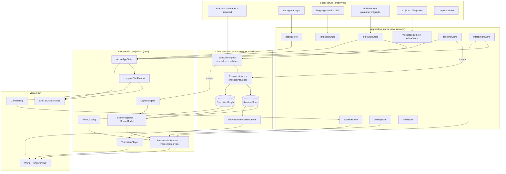
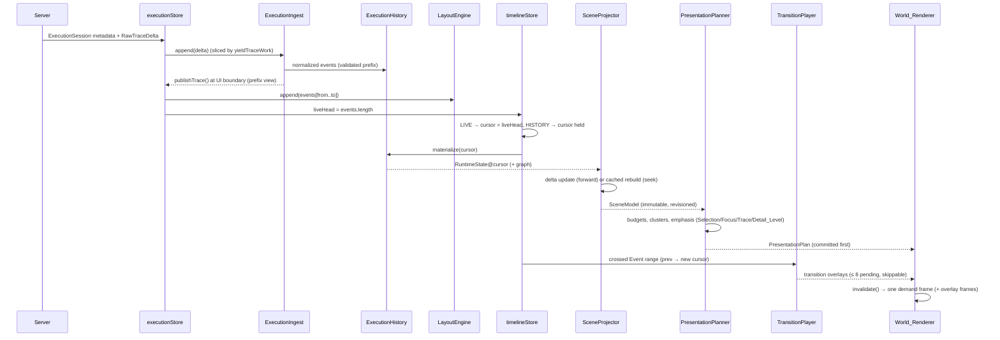
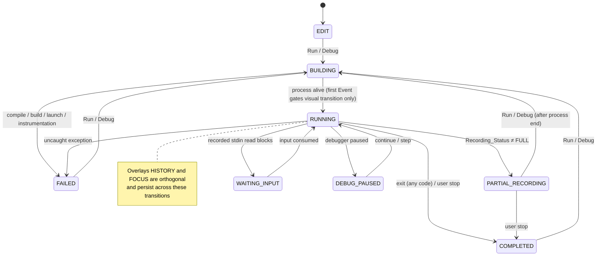

# Design Document — Reference-Exact Rebuild

## Overview

This design defines the final architecture of GGJavaEZ as one production application: a persistent, full-bleed 3D runtime World with a complete Java IDE floating over it. It implements every requirement in `requirements.md` and uses `audit.md` as its evidence base (reference analysis, tokens, gap analysis, preserved-substrate and replaceable-presentation inventories).

The semantic substrate (audit §5) is unchanged. Everything from `SceneModel` upward — application state, shell, layout, presentation planning, camera, motion, renderer, UI surfaces and QA harness — is rebuilt on top of it. Renderer, layout, camera and animation data never enter `RuntimeState` or `ExecutionGraph`.

### Design principles

1. **Truth first, presentation second.** Every visible runtime element is a projection of `RuntimeState`/`ExecutionGraph` at the Cursor and carries the evidence id that introduced it. The projection is pure and cached. Clusters, headings, bundles and empty-state text are Structural_UI and never look like runtime entities.
2. **One world, many states.** `AppState` is a pure derivation of semantic and interaction inputs. State changes recompose the same Shell and World. There is one canvas element, one route per mode (`/` and `/examples`) and one SceneModel per Recording.
3. **Stable space.** Every anchor is assigned once, append-only, from generic semantics (call tree, runtime type, ownership, allocation order). Cursor, Lens, Detail_Level, Selection, Focus and Quality_Tier never move an anchor.
4. **User input always wins.** The Camera_Rig owns the pose. Guided_Moves are cancellable intents; any manual orbit/pan/zoom cancels them within one frame and turns Follow off.
5. **Bounded presentation.** Nominal targets permit reported mandatory-target overflow. Background queries/transitions/lists stay bounded. Recorded truth stays in the substrate; missing content stays unavailable.
6. **Commit before animate.** Semantic state for a new Cursor commits synchronously. Motion is a presentation overlay that can be skipped, coalesced or cut without changing what is true.
7. **Same SceneModel, two pipelines.** INTERACTIVE and CINEMATIC render the identical SceneModel and PresentationPlan; only materials and post-processing differ.

### Scope of change (summary)

| Layer | Treatment |
| --- | --- |
| Server, instrumentation, normalization, validation, RuntimeState, ExecutionGraph, history/seek, debug, JDT, filesystem, build, Console truth | Preserved. No contract or Semantic_Golden changes |
| `src/world/sceneModel.ts` | Rewritten as an incremental projector; same truth discipline, extended presentation-only projections |
| Layout | One new `LayoutEngine` replaces `spatialLayout.ts`, `layout.ts`, `layoutForTrace.ts`, `examples/curatedLayout.ts`, `examples/scopedLayout.ts` |
| Planner | `presentationPlanner.ts` replaces `spatialPresentation.ts`, keeping its budget architecture |
| Camera | `src/camera/**` replaces `src/navigation/**` (THEATER removed) |
| Renderer | `src/render/**` replaces `src/scene/**` (new primitive set, material factory, typography, lighting, post-processing, quality tiers) |
| Shell + IDE | `src/shell/**` + decomposed stores in `src/workspace/**` replace `IdeWorkspace.tsx`, `App.tsx` and all old chrome/CSS |
| Deleted | Classic runtime, Theater, `App.tsx` shell, old IDE chrome, matte primitives, legacy layout kinds and their CSS |

### Key design decisions

| # | Decision | Rationale |
| --- | --- | --- |
| D1 | AppState displays orthogonal process/build, recording, debugger, input and Cursor/Lens dimensions; commands use underlying facts | Partial recording never implies process death |
| D2 | Shell geometry is a pure function `computeShellLayout(viewport, appState, flags)` returning rectangles, the Safe_Frame and the Viewport_Class | One source of truth for CSS, camera fitting and QA rectangle measurement (Requirements 2, 3, 30, 34.5) |
| D3 | The Stack is a single X column: callee below caller (gap 0.10 u) recessed 1.25 u in −Z; later siblings form a +Z History_Deck. Frame slab height is fixed at entry from the method signature | Requirements 8.5–8.8 require positions that depend only on the call tree and never move; a signature-derived height is the only height that keeps both the 0.10 u gap and call-tree determinism (see "Requirements clarifications") |
| D4 | Heap project objects form one column per runtime type (pitch = column width + 2.4 u), three tiers per page, pages advancing in +Z; library/JDK objects sit in a summary sub-region behind page 0 | Requirements 11.1–11.8: library region stays behind every project column forever because project pages only grow toward the camera |
| D5 | Class_State is a teal shelf band above the stack and heap headings | "Above" is the only direction in which neither the stack (grows −Y, ±Z) nor the heap (grows +X, +Z, −Y) ever expands (Requirement 13.1) |
| D6 | Flows are queried from a `FlowCatalog` over ExecutionGraph edges with append-only bundle indices instead of being materialized per Cursor | Requirement 17 (one Flow per edge, exact counts) at million-edge scale without O(E) work per seek |
| D7 | The renderer is React Three Fiber with demand rendering, instanced bodies, troika `BatchedText` and merged screen-space line batches | Draw calls ≤ 250 and submission ≤ 6 ms p95 (Requirement 32.3–32.4) with cinematic materials |
| D8 | Post-processing uses only `three/examples/jsm` passes already shipped with three 0.186.1; CINEMATIC passes load in a lazy chunk | No new runtime dependency; Requirement 32.7–32.8 |
| D9 | Emissive-only bloom uses explicit mask/layers and depth-aware composition, not threshold alone | Faces/text/grid/reflections excluded |
| D10 | Environment lighting is generated locally from drei `Lightformer`s into a cube map; no HDR preset is fetched | Local, offline product; no outbound network requests |
| D11 | Monaco stays a flat DOM overlay inside the floating Source_Panel (no 3D tilt) | Monaco hit-testing breaks under CSS 3D transforms (audit §8); Requirement 3.19 |
| D12 | One stylesheet (`src/shell/shell.css`) generated from design tokens v4 CSS variables | "No three overlapping CSS systems" |
| D13 | `fast-check` 4.10.2 (exact pin, devDependency) for property tests; `src/testing/traceGen.ts` remains the raw-trace generator | Standard PBT library for TypeScript; generator already produces valid Recorder streams without fixture names |

Ten places where requirements pull against each other (for example Frame row capacity versus call-tree-only anchors, and Run being disabled versus Run offering a restart) are resolved explicitly in "Requirements Clarifications" at the end of this document.

### Research findings that shape the design

All findings were verified against the installed packages in `node_modules` rather than assumed.

- **three 0.186.1** ships `EffectComposer`, `RenderPass`, `UnrealBloomPass`, `GTAOPass`, `SMAAPass`, `BokehPass`, `OutputPass` (and `SSRPass`, `SAOPass`, `TAARenderPass`) under `three/examples/jsm/postprocessing/`, and `Line2`/`LineSegments2`/`LineMaterial` under `three/examples/jsm/lines/` with pixel-space line width. `MeshPhysicalMaterial` provides `transmission`, `thickness`, `ior` and `attenuationColor`. See the [three.js post-processing manual](https://threejs.org/manual/#en/post-processing) and [MeshPhysicalMaterial docs](https://threejs.org/docs/#api/en/materials/MeshPhysicalMaterial).
- **@react-three/drei 10.7.9** provides `Environment` (renders children such as `Lightformer` into a cube map when no `files`/`preset` is given), `Lightformer`, `ContactShadows`, `MeshReflectorMaterial`, `Instances`, `Bvh`, `PerformanceMonitor` and `AdaptiveDpr`. Drei's `Environment` `preset` option downloads HDR files from a CDN, so the design uses `Lightformer` children only. See the [drei documentation](https://drei.docs.pmnd.rs/).
- **troika-three-text 0.52.5** includes `BatchedText`, which renders many SDF text instances in one draw call. Text stays crisp at any distance because glyphs are signed-distance fields. See [troika-three-text](https://protectwise.github.io/troika/troika-three-text/).
- **@react-three/fiber 9.8.1** supports `frameloop="demand"` with `invalidate()`, and `useFrame(callback, priority > 0)` to take over rendering for an `EffectComposer`. See the [R3F performance guide](https://r3f.docs.pmnd.rs/advanced/scaling-performance).
- **Monaco 0.57** must be laid out with `editor.layout()` after container resizes; it does not hit-test correctly under CSS 3D transforms. The Source_Panel animates its width/height as a flat element and calls `layout()` per animation frame.
- **fast-check 4.10.2** is the current release on npm and integrates with vitest through `fc.assert(fc.property(...), { numRuns })`. See [fast-check documentation](https://fast-check.dev/).
- The current code already provides strong foundations: persistent radix storage (`src/runtime/storage.ts`), bounded checkpointed history (`src/runtime/history.ts`), incremental ingest with prefix publication (`src/execution/ingest.ts`), graph-only flow derivation (`src/motion/semanticTransition.ts#graphTransition`), budgeted planning (`src/world/spatialPresentation.ts#spatialBudgets`), bounded connector routing (`src/world/connectorRouting.ts`), demand rendering and frame profiling (`src/scene/FrameProfiler.tsx`). The design keeps these mechanisms and replaces their presentation.

Content from the cited documentation was rephrased for compliance with licensing restrictions.

## Corrected shared contracts

This section specifies the implementation boundary for the numbered components/properties. It preserves the full product/reference mandate, not the old visible architecture. No new semantic facts or visualization fields enter RuntimeState, ExecutionGraph or server DTOs. Presentation adapters may relocate operational responsibilities and expose indexes over preserved facts.

### Sequencing adapter and history ownership

Three coordinates remain distinct:

- Raw seq is Recorder/transport order. `lastRecordedSeq` is the inclusive last accepted RAW seq, null when none; derive end-exclusive raw acceptance R using the preserved transport convention, not a guessed semantic count.
- Normalized seq s is zero-based order in the accepted TraceDocument. One raw Event may emit multiple normalized Events; deferred dependency emissions can depend on several raw Events.
- Cursor c is the number of applied normalized Events; seek(c) applies [0,c). Live_Head N is the published accepted semantic-prefix length. Event at Cursor is Events[c−1] only if c > 0.

The normalization adapter maintains a sidecar mapping keyed by `(sessionId, recordingId, prefixRevision)`: `{acceptedRawEndExclusive, normalizedPrefixEnd}` at completed normalization/publication boundaries. R→N(R) includes all emissions validated from that fully accepted raw prefix and no emissions requiring raw evidence outside it. If a raw normalization group is incomplete, withhold its publication rather than expose a partly applied group. Deferred emissions extend N only after prerequisites are accepted. Stop metadata remains unchanged; a CAPTURE_STOP sentinel is not a fabricated program-end Event. The preserved normalizer may append CAPTURE_STOP, PROGRAM_END or PROGRAM_ABORT from real stop/terminal metadata during finish(), without a new accepted Java probe. Therefore the mapping is keyed by raw boundary AND normalizer publication/terminal revision: N(R, revision), abbreviated N(R) at the current revision. Include those actual normalized control Events when published; never invent them or drop them to make N equal a raw count. A control Event updates recording/termination status, not observations of later Java execution.

Timeline bounds are [0,N(R)] for FULL and stopped recordings alike. LIVE follows N, HISTORY holds c including 0. Partial markers and Return to Live use N, never raw lastRecordedSeq. At c = 0 show empty runtime and "Before execution"; normalized sequence readout is absent. Map a visible Event ordinal as c, not raw seq. Replay starts at 0. Indexes use seq < c; timestamps remain timestamps.

Each `WorldSource` retains its session/Recording identity, prefix revision, trace, history handle, cursor/liveHead/lens, layout anchors, detail level, selection, valid Focus, navigation snapshot, historical source bindings and Console association. New attempt identity/build diagnostics are separate. Source panels explicitly identify historical source versus new editable source. Subscription keys include session/Recording/prefix revision, and stale callbacks cannot mutate another context. `RetainedHistoryHandle` and source/navigation aliases wrap the existing history/binding representations; they do not duplicate reduction. Do not dispose retained history when creating a pending attempt; retire it only after committed replacement or explicit disposal.

### Orthogonal execution inputs and command service

```ts
interface ExecutionDimensions {
  attemptId: string | null
  build: 'idle' | 'building' | 'launching' | 'failed' | 'ready'
  instrumentation: 'pending' | 'recording' | 'stopped' | 'run-only' | 'failed'
  process: 'unknown' | 'starting' | 'alive' | 'ended' | 'none'
  recording: RecordingStatus | null
  debugger: 'inactive' | 'running' | 'paused' | 'ended'
  input: { available: boolean; wait: 'waiting' | 'not-waiting' | 'unknown' }
  view: { recordingId: string | null; cursor: number; liveHead: number; lens: TimelineLens }
}
```

These inputs are reconciled from the bridge, session and debugger, never inferred from first normalized Event or a friendly label. Unknown liveness disables new starts until reconciled. Pause beats input wait; both beat zero-event/partial labels. Partial recording is always retained as metadata/badge while process-alive/wait/pause remains explicit. Session terminal failures/user stop keep termination facts plus partial status; stderr alone changes neither lifecycle nor forensic state. Input availability is a real capability, not proof of waiting or consumption.

`runCommandAvailability(dimensions, debug)` distinguishes Run/Debug-start, Continue, Step, Stop, Restart and input. No active build/launch or alive/unknown process permits a second start. All entry points share this logic. The command dispatcher explicitly routes navigation/view/workbench, file/editor and debugger commands; breakpoint toggle is not a tab-close action. Projectless actions are not blocked by file-project predicates. Use separate synchronous presentation dispatch from serialized asynchronous filesystem/launch transactions; retain workspace-generation guards and at-most-once action execution.

### Operational IDE adapters

| Responsibility | Owner after extraction | Preserved safeguard |
| --- | --- | --- |
| Source-proof generations and main/launch reconciliation | workspace execution/source coordinator | Build-manifest/source revisions checked before binding/launch; explicit runnable target validation |
| Dirty drafts, saved/closed draft decisions | project/draft coordinator | Per-file revision conflicts, concurrent edits retained; dirty transition must complete before Run |
| Rename receipts/recovery | filesystem transition coordinator | Same operation nonce replay, journal recovery, atomic tab/draft/source mapping, failed/uncertain receipt handling |
| Historical source bindings | source-binding coordinator retained by WorldSource | Recording source proof stays associated with its execution; edits never rewrite history |
| Monaco lifecycle | editor model registry | Keep models/view state across surface moves; retire only after all owners release |
| JDT documents | language/document coordinator | Open/change/close ordering and request generation checks survive shell deletion |
| Breakpoints/source mapping | debug/source coordinator | Reconcile resolved locations and renamed paths against actual source generations |

Current Save All aborts on the first thrown save error. Requirement 5.8 deliberately improves the UI operation to attempt remaining selected files and return per-file successes/failures; failed drafts remain dirty. This is not unchanged reuse. Save All and Run requires every required save successful and the source-proof/launch barrier revalidated. Never turn partial Save All success into authorization to launch stale sources.

### Observation, evidence, identity and endpoints

`ValueText` exact content means all captured content, not original unrecorded suffixes. Add presentation-only `observation: OBSERVED | TRUNCATED | UNAVAILABLE | PARTIALLY_OBSERVED`, optional captured length/preview count and reason. It interprets existing String truncation, sparse arrays, unavailable RuntimeValues and bounded library summaries without altering those contracts. Java defaults require captured initialization/allocation evidence; first post-constructor observation is not allocation-time proof. Snapshot changes show observed differences; do not infer intervening collection operations.

`Evidence` distinguishes observed Event/graph IDs, documented derived summaries over captured inputs, and unavailable metadata. `introducedSeq`/`changedSeq` are nullable; a projected item does not automatically have a recorded source-changing Event. Missing source location/cause/stack text stays unavailable. Cause completeness and exception-path completeness are separate. Process stderr stack text is identified as process text, not upgraded into graph provenance.

Canonical identity preserves JVM binary names/descriptors including literal `$`. Display labels may use source spelling when metadata establishes nesting; otherwise keep unambiguous binary spelling. Display is not a reversible identity codec. All lookup/selection/cluster/provenance keys use canonical identity.

Query the preserved graph snapshot at applied-prefix c (or an equivalent proven prefix index), and resolve edge Event IDs through the actual trace/fact index, never by parsing numeric IDs as raw/normalized seq. `RecordedProvenance` contains original edge ID/kind, graph endpoints, captured evidence IDs/sequences and observed/derived/unavailable endpoint status. `recordedProvenanceOf` traverses all supported graph kinds at prefix c, including COMPUTE/OBSERVE/file evidence even without a curve. `drawableFlowsOf` separately resolves presentation geometry. Endpoint resolver indexes preserved RuntimeState/graph IDs, not labels:

| Endpoint | Identity/mapping |
| --- | --- |
| local/parameter/receiver | invocation + stable slot ID, with current lexical presence/row mapping |
| instance field | object + declaring owner + field slot ID |
| static field | canonical class ID + static slot ID |
| array cell | object + semantic index/slot ID → current windowRevision map |
| collection entry | recorded semantic summary slot ID; snapshots retire removed slots, never identify by equal value |
| I/O | actual console/input graph endpoint and stream; submitted text alone does not prove consumption |
| exception | captured Throwable/throw/unwind/catch graph IDs, not parsed nearby stderr |
| return destination | exact graph-proven destination storage/value ID; absent destination has no curve |

Hidden or unavailable Ports return a reason and optional Reveal action. Never attach hidden array flows to ellipsis. General reference aggregation may use a truthful labelled cluster bundle; provenance Flows never substitute a cluster for an absent endpoint. Inspector/Trace exposes non-drawable evidence structurally. Empty drawable list cannot justify "No recorded provenance".

### Layout, text, cinematic resources and QA readiness

Fixed world proportions specify local solids/canonical comparison states, not a bound on arbitrary world size. Stable layout may grow or page spatial regions; append-only anchors never relayout on Home. Viewport-aware region headings follow chosen representatives using presentation-only placement; distant extrema do not determine global heading visibility. I/O/class headers avoid the visible region bounds. Home limits representatives to readable fits and uses truthful coarser region summaries for remaining topology. Focus reveals any real target, including by array-window remapping.

Array mapping is `(recordingId, objectId, semanticIndex, slotId) → (windowRevision, presentedSlot, anchor, port)`. Picks reject stale revisions. Selected/focused/active indices are mandatory; grow the temporary window under overflow rules if needed. Small-array coordinates remain fixed. A window revision may change virtualized cell positions, but no values or provenance are reordered by display slot.

Inspector: ≤ 200 mounted summary rows TOTAL, ≤ 20 overscan and every entry reachable; Console: visible rows plus ≤ 200 OFFSCREEN rows. Full recorded wrapped text opens in a separate variable-height/detail region, preserving copyable characters. Missing array positions are lazy unavailable rows, never eagerly materialized for a huge length. Shell/Monaco minimum 12 CSS px; world title/row text visibility cutoff 11 CSS px, visible Cluster labels/headings minimum 12. Optional world labels are culled rather than reduced below cutoff; selected detail is available in Focus/Inspector. Identity weight is 500, titles/values 600, rows 500, types 400.

`textSystem` groups batches by font URL, weight, material role, opacity policy and mask/layer. If per-instance opacity is unsupported, rebuild bounded shared opacity buckets; child material overrides in BatchedText are not assumed. Prewarm exact font-only and characters/glyph cache keys for every used font/weight/consumer with one finite tracked promise per key, and include newly required glyph sync in readiness. Avoid endless suspense/invalidation loops. Retired batches release children/buffers/material references; dispose shared fonts/atlases only when their owner ends, with ref counting and no double disposal.

A renderer readiness barrier keyed to scene/window/plan/pose/resource revision waits for asset promises, glyph layout/GPU upload, environment/reflection/masks and stable animation/quality state. It has a finite timeout that fails capture with a reason, not a partial screenshot presented as success. QA captures only after the barrier and verifies tilted Focus face/text sharpness, no face/grid/reflection bloom, line opacity, picking and truthful port attachments.

Selective bloom uses explicit emissive mask/layers with occlusion depth so glow does not paint over unrelated opaque faces. Varying curve alpha uses a tested shader attribute or curve-parameter uniform lookup multiplied by global emphasis; stock LineMaterial alone is not sufficient. DOF uses sharp target-face/text compositing with correct depth and transparent-edge treatment, or a validated target-aware focus strategy; disable DOF if it harms readability. Unsupported effects report capability/fallback, never hide runtime content. Measure added passes/uploads against budgets; keep cinematic transmission, lighting and reflection ambition.

## Architecture

### Layered architecture



Dependency rule: arrows only point upward from substrate to view. Nothing in `Projection` or `View` writes to `RuntimeState`, `ExecutionGraph`, `ExecutionHistory` or the server. The only writes to the substrate are the preserved ones: ingest appends, debug commands, file operations, builds and runs.

### Data flow: ExecutionSession → World



Commit order per Cursor change (Requirement 18.6, 1.23, 31.14): `timelineStore.cursor` → `RuntimeState` → `SceneModel` → `PresentationPlan` → `AppState`/Shell/Inspector/Console/Time_Dock → first rendered frame → transition overlays. Each step is synchronous within one task except projection for very large seeks, which still completes before the first frame that shows the new Cursor.

### Store topology

All application state lives in focused zustand stores (zustand 5 is already a dependency). Stores hold plain data and expose actions; React components subscribe with selectors. No store imports a view module.

| Store | File | Owns | Replaces |
| --- | --- | --- | --- |
| `workspaceStore` | `src/workspace/workspaceStore.ts` | projects, active project id, workspace generation, file tree, JDK status, Java project model, launch configuration | ~15 `useState` hooks in `IdeWorkspace` |
| `editorStore` | `src/workspace/editorStore.ts` | tabs, drafts, closed-draft index, active path, caret/scroll memory, recorded-source view | tabs/drafts/nav state in `IdeWorkspace` |
| `executionStore` | `src/workspace/executionStore.ts` | current `ExecutionSession`, `ExecutionIngest`, presented `TraceDocument`, Prior_World, `LayoutEngine` instance, build result, user-stop marker, launch flow | execution/visualization state in `IdeWorkspace`, `App.tsx` trace selection |
| `debugStore` | `src/workspace/debugStore.ts` | breakpoints (desired + resolved projection), debug session status/pause | breakpoint projection in `IdeWorkspace` |
| `languageStore` | `src/workspace/languageStore.ts` | `LanguageClient` snapshot, diagnostics | `languageSnapshot` state |
| `timelineStore` | `src/timeline/timelineStore.ts` | Cursor, Lens, playing, direction, speed, scrub-drag flag, Live_Head | `usePlayback`, `resolveTimelinePosition`, lens state |
| `interactionStore` | `src/interaction/interactionStore.ts` | Selection, Focus target, pre-Focus snapshot, Trace mode/scope, hover, accessible-list cursor | selection state in `App.tsx`, `isolatedSelection` in navigation store |
| `cameraStore` | `src/camera/cameraStore.ts` | navigation mode, Follow flag, pose snapshot, active Guided_Move, Detail_Level, view revision | `src/navigation/navigation.ts` store |
| `qualityStore` | `src/render/quality/qualityStore.ts` | Quality_Tier setting, active pipeline, GPU capabilities, auto-switch notice, reduced motion (OS + in-app) | `renderQuality` select, `animationQuality.ts` |
| `shellStore` | `src/shell/shellStore.ts` | Explorer open (+ EDIT memory), Source expansion, Dock drawer + height, Inspector open, popovers, dialogs, picker | layout `useState` hooks in `IdeWorkspace` and `App.tsx` |

The command layer (`src/ide/commands.ts`) keeps its contract. `src/workspace/commandHost.ts` builds the `IdeCommandHost` from the stores: `snapshot()` reads store state, `operations` are adapters in `src/workspace/operations/*`, `prompts` open shell dialogs and resolve promises.

### Module map

Paths are relative to the repository root. "Preserved" modules keep their public contracts; small internal changes are listed where needed.

#### New modules

| Path | Purpose |
| --- | --- |
| `src/state/appState.ts` | `AppState` types, `deriveAppState`, label/icon formatting, `runCommandAvailability` |
| `src/state/useAppState.ts` | Hook that gathers inputs from stores and memoizes `deriveAppState` |
| `src/shell/Shell.tsx` | Production shell root for `/` (IDE) and `/examples` (recording viewer) |
| `src/shell/shellLayout.ts` | `computeShellLayout`, `viewportClass`, Safe_Frame, rectangle tokens |
| `src/shell/shellStore.ts` | Shell surface state |
| `src/shell/Header.tsx`, `ModeBar.tsx`, `RunCluster.tsx`, `AppStateBadge.tsx` | Header band |
| `src/shell/source/SourcePanel.tsx`, `TabBar.tsx`, `ExplorerDrawer.tsx`, `sourceSync.ts`, `RecordedSourceView.tsx` | Floating source surface and runtime-source synchronization |
| `src/shell/time/TimeDock.tsx`, `MilestoneTrack.tsx` | Time_Dock |
| `src/shell/dock/Dock.tsx`, `ConsoleDrawer.tsx`, `ProblemsDrawer.tsx`, `DebugDrawer.tsx`, `ErrorsDrawer.tsx`, `StatusPopover.tsx` | Dock strip, drawers and status popover |
| `src/shell/inspector/InspectorCard.tsx`, `inspectorModel.ts` | Contextual Inspector |
| `src/shell/debug/DebugBar.tsx` | Floating debug controls |
| `src/shell/picker/Picker.tsx` | Quick_Open, Command_Palette and workspace symbol search (one picker component) |
| `src/shell/dialogs/*.tsx` | Unsaved changes, delete confirmation, path input, run-restart confirmation, dirty-run decision, launch configuration (moved `LaunchDialog`) |
| `src/shell/a11y/Announcer.tsx`, `SkipLinks.tsx`, `focusRegions.ts`, `Tooltip.tsx` | Accessibility primitives |
| `src/shell/shell.css` | The single production stylesheet, driven by token CSS variables |
| `src/workspace/*Store.ts`, `commandHost.ts`, `operations/{files,tabs,run,debug,language}.ts` | Decomposed IDE state and command operations |
| `src/timeline/timelineStore.ts`, `milestones.ts` | Cursor/Lens/playback and the milestone index |
| `src/interaction/interactionStore.ts`, `accessibleEntities.ts` | Selection, Focus, Trace, accessible entity list |
| `src/world/layoutEngine.ts`, `occupancy.ts` | Reference layout engine and its append-only spatial index |
| `src/world/sceneModel.ts` (rewritten), `sceneProjector.ts` | Incremental SceneModel projection |
| `src/world/flowCatalog.ts` | ExecutionGraph edge → Flow queries and bundle counts |
| `src/world/presentationPlanner.ts`, `budgets.ts`, `clusters.ts`, `detailLevel.ts`, `traceEmphasis.ts` | Presentation planning |
| `src/world/exceptionPath.ts`, `collectionSummary.ts`, `returnFlows.ts`, `frameStatus.ts`, `valueText.ts` | Presentation-only projections and the single value formatter |
| `src/camera/cameraStore.ts`, `CameraRig.tsx`, `poses.ts`, `guidedMoves.ts`, `homeFraming.ts`, `projection.ts`, `cameraConstraints.ts` (moved) | Camera ownership |
| `src/motion/transitionPlayer.ts`, `clock.ts` | Transition queue and a pluggable clock (deterministic in QA) |
| `src/render/WorldCanvas.tsx`, `WorldScene.tsx`, `picking.ts`, `contextLoss.ts` | Renderer host |
| `src/render/materials/materialFactory.ts`, `acrylicChunks.ts`, `palette.ts` | Material system |
| `src/render/text/textSystem.ts`, `FaceText.tsx` | Typography |
| `src/render/primitives/*.tsx` | `FrameSlab`, `ObjectBlock`, `ArrayTray`, `CollectionBlock`, `ClassShelf`, `ConnectorBatch`, `Port`, `ReturnFlow`, `FlowBatch`, `ExceptionPanel`, `IoPort`, `ClusterVolumes`, `QuietVolumes`, `RegionHeading`, `StructuralText`, `Floor`, `EnvironmentRig`, `LightRig`, `ContactBlobs` |
| `src/render/post/PostPipeline.tsx`, `interactivePipeline.ts`, `cinematicPasses.ts` (lazy chunk) | Post-processing |
| `src/render/quality/qualityStore.ts`, `gpuCapabilities.ts`, `pipelineGovernor.ts`, `frameTimeWatchdog.ts` | Quality tiers |
| `src/qa/qaBridge.ts` | QA-only window hooks (enabled by `?qa=1` outside production builds, or `VITE_QA=1`) |
| `e2e/reference/*.spec.ts`, `scripts/reference/*.mjs` | Reference convergence harness |

#### Changed modules

| Path | Change |
| --- | --- |
| `src/main.tsx` | Renders `<Shell mode="ide">` for `/` and `<Shell mode="recordingViewer">` for `/examples`; lazy-loads the World renderer and Monaco |
| `src/contracts/world.ts` | SceneModel v2 types (see Data Models); removes `theater`, `layoutKind`, `scopes` legacy fields |
| `src/contracts/interaction.ts` | `Selection` adds `flow`, `cluster`, `arrayCell`; `CameraMode` replaced by `NavigationMode`; `PlaybackState` gains `direction` |
| `src/ide/commands.ts` | `ShellCommandId` gains navigation, view, timeline and quality commands; titles adjusted ("Rename" for filesystem rename). `createIdeCommandService` logic unchanged |
| `src/ide/shortcuts.ts` | Bindings table for new commands; `F1`, `F9`; matcher unchanged |
| `src/ide/contextMenus.ts` | Explorer and tab menus per Requirements 4.5/4.16 |
| `src/ide/ProjectExplorer.tsx` | Tree component reused inside `ExplorerDrawer`; persistent panel styling removed |
| `src/ide/EditableJavaEditor.tsx`, `src/ui/monacoSetup.ts`, `src/language/monaco.ts` | Reference-matched Monaco theme, gutter glyphs, execution/history/exception line decorations |
| `src/ui/ConsolePane.tsx` | Virtualized line list, stdin marking, truncation notice; styling moves to `shell.css` |
| `src/debugger/ErrorExplorer.tsx` | Content reused by `ErrorsDrawer`; navigation callbacks adapted |
| `src/motion/semanticTransition.ts` | Exports `graphTransition` for `FlowCatalog`; derivation logic unchanged |
| `src/theme/tokens.ts`, `docs/visual-java-spec/DESIGN_TOKENS.json` | Design tokens v4 |
| `src/testing/traceGen.ts` | Optional shapes for arrays, collections, exceptions, stdin used by property tests |
| `package.json` | `fast-check` 4.10.2 devDependency; `test:reference`, `qa:reference` scripts |

#### Deleted modules (after their replacement is verified)

`src/classic/**`; `src/app/App.tsx`, `src/app/styles.css`, `src/app/layoutForTrace.ts`, `src/app/animationQuality.ts`; `src/ide/IdeWorkspace.tsx`, `src/ide/ide.css`, `src/ide/ProjectExplorer.css`, `src/ide/TraceInspector.tsx`, `src/ide/TraceInspector.css`, `src/ide/WorkspaceMenu.tsx` (folded into the header project menu); `src/ui/SourcePane.tsx`, `src/ui/SourceEditor.tsx` (folded into `RecordedSourceView`), `src/ui/Inspector.tsx`, `src/ui/runtimeOptions.ts`, `src/ui/timeline/Timeline.tsx`, `src/ui/timeline/Timeline.css`, `src/ui/ConsolePane.css`; `src/debugger/DebugPanel.tsx`, `src/debugger/debugger.css`; `src/examples/curatedLayout.ts`, `src/examples/scopedLayout.ts`, `src/examples/ControlFlowStatus.tsx`, `src/examples/captions.ts`; `src/world/spatialLayout.ts`, `layout.ts`, `spatialPresentation.ts`, `detailedScene.ts`, `isolatedScene.ts`, `objectFace.ts`, `arrayGeometry.ts`, `runtimeHeadings.ts`, `callStructure.ts`; `src/navigation/**`; `src/scene/**` (profilers move to `src/render/metrics/`); `src/contracts/visualization.ts`; `src/playback/usePlayback.ts` (pure `playbackState.ts` moves to `src/timeline/`). Their tests are replaced by tests of the new modules; semantic tests are untouched.


## Components and Interfaces

### 1. Application state

`AppState` is derived, never stored. `useAppState()` gathers inputs from `executionStore`, `debugStore`, `timelineStore` and `interactionStore` and memoizes `deriveAppState` on input identity. Stores commit synchronously, so the Header label updates in the same React commit as the input change (Requirement 1.23) and never waits for animation.

```ts
// src/state/appState.ts
export type ExecutionState = 'EDIT' | 'BUILDING' | 'RUNNING' | 'WAITING_INPUT' | 'DEBUG_PAUSED' | 'COMPLETED' | 'FAILED' | 'PARTIAL_RECORDING'
export type Overlay = 'HISTORY' | 'FOCUS'
export type FailureKind = 'compile' | 'build' | 'instrumentation' | 'launch' | 'uncaught-exception'
export type Termination = { kind: 'exit'; exitCode: number; durationMs: number } | { kind: 'user-stop'; durationMs: number }
export type WorldOrigin = 'none' | 'session' | 'prior' | 'recording'

export interface AppStateInputs {
  session: Pick<ExecutionSession, 'id' | 'kind' | 'phase' | 'support' | 'supportReason' | 'failureKind' | 'exitCode'
    | 'terminalStatus' | 'recording' | 'build' | 'diagnostic' | 'startedAt'> | null
  /** Normalized events ingested for `session` (0 until the first Event). */
  sessionEventCount: number
  dimensions: ExecutionDimensions // reconciled bridge/session facts, not display label
  /** Recorded at stop time by executionStore; ExecutionPhase 'STOPPED' is only produced by a user stop. */
  endedAt: string | null
  debug: { status: DebugSession['status']; pause: DebugPause | null } | null
  world: { origin: WorldOrigin; eventCount: number; cursor: number; lens: TimelineLens }
  focusTargetId: string | null
  recordingViewer: { status: RecordingStatus; ended: boolean } | null
}

export interface AppState {
  execution: ExecutionState
  /** Ordered HISTORY then FOCUS; each at most once. */
  overlays: readonly Overlay[]
  failure: FailureKind | null
  termination: Termination | null
  partial: Pick<RecordingStatus, 'state' | 'reason' | 'budget' | 'lastRecordedSeq'> | null
  worldOrigin: WorldOrigin
  dimensions: ExecutionDimensions
  badges: readonly string[] // recording completeness and uncertain liveness
  /** e.g. "Running · History · Focus", "Partial recording · <reason>", "Build failed · 3 errors" */
  label: string
  icon: AppStateIcon // one distinct glyph per Execution_State
}
export function deriveAppState(inputs: AppStateInputs): AppState
```

Precedence table for `execution` (first matching row wins):

| # | Condition | Execution_State | Detail |
| --- | --- | --- | --- |
| 1 | `session === null` and `recordingViewer` | `COMPLETED` or `PARTIAL_RECORDING` | from the curated Recording's status |
| 2 | `session === null` or `phase === 'IDLE'` | `EDIT` | |
| 3 | build/launch starting without actual pause/input wait | `BUILDING` | display only |
| 4 | `phase === 'FAILED'` | `FAILED` | `failureKind` build → `compile` when `build.diagnostics` has ≥ 1 compiler error, else `build`; launch → `launch`; capture → `instrumentation`; runtime → `uncaught-exception` |
| 5 | terminal phase and `terminalStatus === 'program_crashed'` | `FAILED` | `uncaught-exception` |
| 6 | `phase === 'STOPPED'` | `COMPLETED` | `termination = user-stop` ("Stopped by user") |
| 7 | `phase === 'COMPLETED'` and `recording.state !== 'FULL'` | `PARTIAL_RECORDING` | Requirement 1.14 |
| 8 | `phase === 'COMPLETED'` | `COMPLETED` | `termination = exit` with exit code (any value) |
| 9 | actual debugger pause | `DEBUG_PAUSED` | before first Event too; retain partial badge |
| 10 | live input-capable process and real wait evidence | `WAITING_INPUT` | recording may be partial |
| 11 | live and recording not FULL | `PARTIAL_RECORDING` | retain process-alive badge/input capability |
| 12 | live and zero normalized Events | `RUNNING` | "Waiting for recording" unless RUN_ONLY |
| 13 | live | `RUNNING` | includes RUN_ONLY / Run Without Visualization |


Overlays: `HISTORY` when `world.eventCount > 0 && world.cursor < world.eventCount` (Cursor below Live_Head); `FOCUS` when `focusTargetId !== null`. Both survive Execution_State changes because they are computed from Cursor/Lens and Focus, not from transitions (1.19). Overlay order in the label is fixed (HISTORY, FOCUS).

`worldOrigin` drives World labels: `prior` shows "Previous run · source changed" after a failed build (1.21) and "Building…" during BUILDING with a Prior_World (6.4).



**Command availability.** `runCommandAvailability(inputs.dimensions, debug)` feeds all command surfaces. New Run/Debug-start is disabled for active build/start or alive/unknown process, including partial recording. Continue/Step requires actual pause; Stop targets active attempt/process; stdin requires a live input-capable process. Restart stops/reaps before launch. Navigation/time/view commands execute outside filesystem queues.

### 2. Shell composition

`Shell.tsx` renders a fixed layer stack. The World canvas is mounted once at the root and never unmounted; every other surface is an absolutely positioned DOM layer whose rectangle comes from `computeShellLayout`.

| Layer (z) | Surface | Persistent |
| --- | --- | --- |
| 0 | `WorldCanvas` (100% × 100%) | yes |
| 1 | World DOM overlays: Structural_UI text, accessible entity list (visually hidden), tooltips anchored to world points | yes |
| 2 | Source_Panel (+ Explorer drawer), Time_Dock, Dock strip | yes |
| 3 | Dock drawer, Inspector card, Debug_Bar, status popover | transient |
| 4 | Header | yes |
| 5 | Picker, dialogs, context menus, tooltips | transient |

```ts
// src/shell/shellLayout.ts
export type ViewportClass = 'WIDE' | 'STANDARD' | 'SHORT' | 'NARROW'
export type SourceSize = 'EDIT' | 'RUN' | 'DEBUG' | 'FOCUS' | 'DRAWER_COLLAPSED' | 'DRAWER_OPEN'
export interface Rect { x: number; y: number; width: number; height: number }
export interface ShellLayoutInput {
  viewport: { width: number; height: number }
  appState: AppState
  hasRuntimeWorld: boolean          // Prior_World or current session World
  sourceExpanded: boolean           // Expand Source in effect
  narrowDrawerOpen: boolean
  explorerOpen: boolean
  inspector: { open: boolean; side: 'left' | 'right' }
  dockDrawer: { open: boolean; heightRatio: number }
  debugActive: boolean
}
export interface ShellLayout {
  viewportClass: ViewportClass
  header: Rect
  source: Rect & { size: SourceSize }
  explorer: Rect | null
  timeDock: Rect
  dockStrip: Rect
  dockDrawer: Rect | null
  inspector: Rect | null
  debugBar: Rect | null
  /** World content fitting rectangle used by CameraRig (Hero, Home, Focus, Follow). */
  safeFrame: Rect
}
export function viewportClass(width: number, height: number): ViewportClass
export function computeShellLayout(input: ShellLayoutInput): ShellLayout
```

Token-driven geometry (W, H in CSS px; tokens in `shell.*` of design tokens v4):

| Surface | WIDE / STANDARD | SHORT | NARROW |
| --- | --- | --- | --- |
| Header | full width, h = clamp(0.080 H, 56, 76) | 56 px | 56 px, icon-only buttons |
| Brand | cube 36–44 px; title 0.024 H w600; subtitle max(12, 0.015 H) muted `#A9B8DA` | same | same |
| Mode_Bar | 4 buttons, h = clamp(0.041 H, 34, 40), w 98–112, radius 8, gap 14 | same | icon-only 40×40 |
| Run cluster | left of Mode_Bar, ≤ 0.18 W, launch name truncated with tooltip | same | icon-only |
| Source_Panel | x 0.006 W, y 0.100 H; size per table below | same | left drawer + peek tab |
| Time_Dock | inset 0.009 W, bottom 0.025 H, h = clamp(0.106 H, 84, 112), radius 12 | h 84 | h 84, overflow menu |
| Dock strip | between Time_Dock bottom and viewport bottom, visual height = min(24, 0.025 H) | same | same |
| Dock drawer | bottom ≥ Time_Dock top, height ∈ [0.20 H, 0.45 H], default 0.30 H | same | same |
| Inspector | w = max(0.20 W, 300), top 0.34 H, max-h 0.52 H, right edge 0.99 W or left side | same | bottom sheet ≤ 0.45 H |
| Debug_Bar | centered on Header (±2 px), top at Header bottom + 8 px | same | same |

Source_Panel size by AppState (precedence top to bottom):

| Condition | Size | Rectangle |
| --- | --- | --- |
| Viewport NARROW | `DRAWER_*` | collapsed peek tab, or open drawer `min(0.86 W, 520)` × (Time_Dock top − Header bottom) |
| FOCUS overlay | `FOCUS` | 0.22 W × 0.56 H (width wins over Expand Source, 3.9) |
| Expand Source in effect | `EDIT` | 0.48 W × 0.76 H |
| DEBUG_PAUSED | `DEBUG` | 0.34 W × 0.66 H |
| Runtime World present (RUNNING, WAITING_INPUT, COMPLETED, PARTIAL_RECORDING, BUILDING with Prior_World, FAILED with Prior_World or uncaught-exception World) | `RUN` | clamp(0.250 W, 340, 470) × 0.56 H |
| otherwise (EDIT, BUILDING/FAILED without World) | `EDIT` | 0.48 W × 0.76 H |

Safe_Frame: `left = source.right + 0.014 W` (0.27 W at RUN size), `right = 0.985 W` (or Inspector left − 0.01 W when the Inspector is on the right), `top = 0.10 H`, `bottom = 0.85 H` (or Time_Dock top − 0.019 H when larger). SHORT clamps the Safe_Frame height to ≥ 0.55 H by shrinking Header/Time_Dock to their minimums. NARROW uses the rectangle below the Header, above Time_Dock and Dock, right of the peek tab (30.8).

**Dock strip hit areas.** The strip's visual band can be 16–24 px (0.025 H). Toggle hit areas are 24 px tall, bottom-aligned to the viewport, extending into the Time_Dock's bottom padding, which contains no controls (30.9, 30.11).

**Surface animation.** Source_Panel width/height animate over 400 ms (300–600 window) from the currently displayed size, interpolating from the in-flight value when interrupted (3.17). `SourcePanel` calls `editor.layout()` each animation frame and restores the view state snapshot (`editor.saveViewState()`) when the animation completes (3.18). Reduced motion applies the final size in one frame.

**Glass surfaces.** All floating surfaces share `.glass` from `shell.css`: fill `rgba(8, 14, 34, 0.72)`, `backdrop-filter: blur(18px) saturate(1.2)`, 1 px border `rgba(160, 190, 255, 0.18)`, inner highlight. Text colors are fixed tokens whose contrast is verified by the QA harness against the composited background (2.19, 31.10).

**Header details.** `AppStateBadge` shows icon + label. `RunCluster` = Run, Debug, Stop, launch configuration dropdown. All buttons read enablement from `commands.availability(id, context)`; disabled controls keep `aria-disabled="true"` (not `disabled`) so they stay in the Tab order (31.1) and expose the reason as tooltip and `aria-describedby` (2.8). `ModeBar` buttons are `aria-pressed` toggles bound to `cameraStore.mode`; exactly one is pressed (2.5).

**Dock.** The strip lists Console, Problems, Debug, Errors toggles with counts (lines, diagnostics, breakpoints + paused stack entries, recorded exceptions) and a status summary naming the Language_Service status with a glyph. One drawer is open at a time; the drawer height is remembered for the session in `shellStore` (2.13–2.14). The status popover shows JDK version, Language_Service status and reason, build system and recording limits (2.15–2.16).

### 3. Source and runtime relationship

`SourcePanel` hosts the Tab_Bar, the Monaco editor (`EditableJavaEditor`), an Explorer toggle, Expand/Collapse Source controls and a header area for "Recorded source" and "No project source" indications.

`sourceSync.ts` is a pure policy that decides, for each relevant input change, which file/line the panel shows:

```ts
export type SourceTarget =
  | { kind: 'executing'; location: SourceLocation }       // RUNNING/LIVE, follows Cursor Event line
  | { kind: 'paused'; location: SourceLocation }          // DEBUG_PAUSED at Live_Head (Requirement 3.8, 7.8)
  | { kind: 'focus'; location: SourceLocation }           // FOCUS target line (3.9, 19.8)
  | { kind: 'history'; location: SourceLocation }         // HISTORY Cursor Event line (3.10, 7.12)
  | { kind: 'exception'; location: SourceLocation }       // recorded throw line (25.1)
  | { kind: 'unavailable'; reason: 'no-project-source' }  // 3.11
export function sourceTargetFor(input: {
  appState: AppState; cursorEvent: TraceEvent | null; focusLocation: SourceLocation | null
  pause: DebugPause | null; bindings: SourceBindings; projectFiles: ReadonlySet<string>
}): SourceTarget | null
export type ScrollPolicy = 'middle-third' | 'reveal' | 'none'
```

Rules:

- Priority: FOCUS > paused (Cursor at Live_Head) > HISTORY > executing. Exception throw lines add a red line marker in addition to the current target.
- Runtime locations map recorded `fileId`s to workspace paths through `SourceBindings` (preserved). If the workspace file's current content hash differs from the recorded hash, `RecordedSourceView` shows the recorded text read-only with the label "Recorded source" and the current draft is untouched (3.14).
- Scroll policy: pauses use `middle-third` once per pause and then respect user scrolling until the next pause (3.8). HISTORY and FOCUS use `reveal`. Executing-line follow during RUNNING uses `reveal` and is suppressed for 2 s after manual editor scrolling.
- Line decorations (Monaco `deltaDecorations`, reference-matched theme): execution line = full-width bar `#3FD8FF` at 18% fill with a 1.5 px border at 70%; history line = dashed outline + "⟲" gutter glyph; paused line = execution bar + "❚❚" gutter glyph; exception line = red `#FF4A5E` marker + "!" glyph. Every state has a glyph so it survives grayscale (31.13).
- Source edits never touch the World (3.15). When any recorded file's editor content hash differs from its recorded hash and a runtime World exists, the Header shows "Source changed since this run" (3.16). Hashes are computed with the existing `sourceSha256` on a debounced draft change.
- Editor typography: JetBrains Mono at 0.016 H, line height 0.029 H at every panel size (3.12). Monaco `fontSize`/`lineHeight` options update when H changes.
- Language_Service unavailability keeps syntax highlighting, editing, drafts and breakpoint gutter; the panel shows "Java language features unavailable" until ready (3.2).

### 4. Explorer, tabs, picker and commands

The IDE operational guarantees survive extracted adapters and one registry. `createIdeCommandService` may adapt shell/navigation/view/breakpoint routing and underlying-state availability; source-proof/filesystem transactions remain authoritative. Projectless shell actions work without a project; camera/time cannot wait behind file I/O.

- **Explorer drawer** (`ExplorerDrawer.tsx`) wraps `ProjectExplorer`'s tree, anchored to the Source_Panel's left edge, width clamp(0.16 W, 0.22 W). It overlays the World (no canvas resize). It closes on Run/Debug start and restores the last EDIT-time state when the Execution_State returns to EDIT (4.3–4.4); `shellStore.explorerOpenInEdit` stores that memory.
- **Context menus** (`contextMenus.ts`): Explorer items show Open, New File, New Java Class, New Folder, Rename, Delete, Reveal in Explorer, Copy Path; tabs show Close, Close Others, Close to the Right, Close Saved, Rename, Reveal in Explorer, Copy Path. Filesystem rename is titled "Rename" (`resource.rename` title change); "Rename Symbol" (`java.renameSymbol`, F2 in the editor) never appears in these menus (4.11).
- **Inline name validation** (`validateEntryName(kind, name, siblings)`) runs before any filesystem operation: empty, path separator, existing sibling, invalid Java identifier for New Java Class (4.13). Java class content comes from the preserved `classCreation.ts` (package from source-root-relative folder).
- **Tabs** (`TabBar.tsx`): one tab per open file, dirty dot, close button, horizontal scroll, active tab scrolled into view (4.15, 4.20). Close flows go through the existing `editor.close*` commands and the `dirty` prompt (Save, Don't Save, Cancel).
- **Picker** (`Picker.tsx`): Quick_Open uses `src/ide/fuzzy.ts` (subsequence match, exact file-name first) over the workspace file index; Command_Palette lists `ideCommandDefinitions` with category, title, shortcut (formatted by `formatShortcut`) and availability; disabled items stay listed with `aria-disabled` and their reason (5.3–5.5). Focus returns to the opener on close (5.6, 31.15).

New `ShellCommandId`s (all with title, category, binding, availability):

| Command id | Title | Binding | Availability rule |
| --- | --- | --- | --- |
| `navigation.explore` | Explore | — | always (enables Follow) |
| `navigation.follow` | Follow | — | runtime World present |
| `navigation.focusSelection` | Focus Selection | `Alt+Shift+F` | Selection is a focusable entity |
| `navigation.exitFocus` | Exit Focus | — | FOCUS overlay active |
| `navigation.traceRelevant` / `traceCurrent` / `traceAll` | Trace: Relevant / Current / All | — | runtime World present |
| `navigation.followPath` | Follow Path | — | Selection is a Flow presented at the Cursor |
| `navigation.home` | Home | `H` while World focused | always |
| `workbench.returnLive` | Return to Live | `Alt+Shift+L` | HISTORY overlay active |
| `workbench.console` / `problems` / `debugger` / `errors` | Show Console / Problems / Debug / Errors | existing | always |
| `workbench.inspector` | Toggle Inspector | `Alt+Shift+I` | Selection or Focus target exists |
| `workbench.expandSource` / `collapseSource` | Expand Source / Collapse Source | — | not NARROW; state-dependent |
| `workbench.nextRegion` | Move Focus to Next Region | `Ctrl+F6` | always (31.4) |
| `view.qualityInteractive` / `view.qualityCinematic` | Quality: Interactive / Cinematic | — | CINEMATIC requires GPU capability (29.13) |
| `view.reducedMotion` | Toggle Reduced Motion | — | always |
| `execution.restart` | Restart | — | live session (6.11) |
| `editor.toggleBreakpoint` | Toggle Breakpoint | `F9` (editor scope) | Java editor active |

`CommandDefinition.scope` gains `'world'` for bindings that apply only while the World has keyboard focus (`H`). `workbench.runtimeFocus` (old "Toggle Runtime Focus", `Alt+Shift+F`) is removed; its binding moves to `navigation.focusSelection`. `workbench.tools` and `workbench.source` are removed with the old chrome. `F1` opens the Command_Palette. The global key handler (`src/shell/keyboard.ts`) matches by physical `code` and exact modifiers (existing `matchesShortcut`), calls `preventDefault()` only for registered chords and lets every unbound chord through (5.15). A disabled command's chord is consumed but not executed (5.16).

### 5. Execution, Run and Prior_World

`executionStore` owns the session lifecycle and wraps the preserved `ExecutionIngest`, `bridge` (`src/ide/client.ts`) and server endpoints.

```ts
interface WorldSource {
  origin: 'session' | 'prior' | 'recording'
  sessionId: string | null
  recordingId: string; prefixRevision: number
  history: RetainedHistoryHandle
  cursor: number; liveHead: number; lens: TimelineLens; detailLevel: DetailLevel
  selection: Selection; focusTargetId: EntityId | null
  navigationSnapshot: RetainedNavigationSnapshot
  sourceBindings: HistoricalSourceBindings
  consoleAssociation: { sessionId: string | null; recordingId: string }
  trace: TraceDocument          // published prefix (ExecutionIngest.publishTrace) or curated trace
  layout: LayoutEngine
  recording: RecordingStatus
}
interface ExecutionStoreState {
  session: ExecutionSession | null
  ingest: ExecutionIngest | null
  world: WorldSource | null         // the World presented now
  pendingWorld: WorldSource | null  // new session before its first Event
  launch: LaunchConfiguration       // persisted per project (6.14)
  endedAt: string | null
}
```

Run flow (Requirement 6):

1. `execution.run` → if dirty files exist, open the dirty-run dialog (Save All and Run / Cancel). Cancel or any save failure starts nothing (6.1–6.2).
2. Start session (`StartExecutionRequest` with launch main class, args, working directory). `phase = BUILDING` → Header shows the BUILDING label and progress within 100 ms (6.3).
3. The presented `world` stays the Prior_World (labelled "Building…"), or the World shows Structural_UI "Building…" when none exists (6.4).
4. Build failure → FAILED; diagnostics go to the Problems_Panel (opened); the Prior_World stays with label "Previous run · source changed"; Source_Panel size, Explorer state and camera pose are unchanged (6.5, 27.6–27.7).
5. First Event ingested → `pendingWorld` replaces `world` in one commit; the Run transition runs: Source_Panel to RUN size, Explorer closes, CameraRig Guided_Move to Hero_Pose, all within 300–600 ms (6.6). The Selection, Focus and Trace state of the Prior_World are cleared because they belong to another Recording; the Forensic_State is cleared (25.14).
6. Live batches: `ExecutionIngest` appends in sliced tasks (`yieldTraceWork`); publication happens at most once per animation frame. LIVE Lens moves the Cursor to the Live_Head; HISTORY holds it (1.19, 23.7).
7. RUN_ONLY / Run Without Visualization: Console keeps captured I/O with channel-order/archive qualifications; the World shows "Console execution · <supportReason>" (6.10).
8. Stop (`execution.stop` or `debug.stop`) terminates within 2 s via the preserved server stop; frames without a recorded return get status "terminated" (6.12–6.13).

`execution.restart` asks for confirmation, performs Stop, waits for the terminal phase and then starts Run (6.11).

### 6. Debug presentation

Debug keeps the preserved debug-manager semantics, `DebugCommand`s, breakpoint resolution and history-cursor separation.

- `debugStore` holds desired breakpoints (per project, persisted with the existing key) and the resolved projection from `projectSessionBreakpoints`. Gutter glyphs: resolved = filled circle `#FF4A5E`, unresolved/pending = hollow diamond `#A9B8DA`; shape differs so grayscale captures distinguish them (7.4).
- `DebugBar.tsx` appears while a debug session is active: Continue/Pause, Step Over, Step Into, Step Out, Stop; each button dispatches the same command id as its shortcut (7.10). Disabled step buttons show "Stepping requires a paused debugger" (the existing `CommandUnavailable` reason, 7.6).
- On pause: `debugStore.pause` updates → AppState DEBUG_PAUSED → Source_Panel to DEBUG size, paused file active, line N in the middle third (7.8); the paused Frame gets the execution halo and status "Paused · line N" within 150 ms (7.7); if Follow is active the CameraRig frames the paused Frame inside the Safe_Frame (7.9).
- HISTORY during pause: the JVM stays suspended; the World shows the Cursor state; the editor shows the history line style; the Time_Dock shows a paused marker at the Live_Head and the count of Events after the Cursor (7.11–7.14).
- The Debug drawer lists breakpoints (file, 1-based line, status) and, while paused, the debugger-reported stack (innermost first) and variables exactly as reported (7.17).
- Long pauses: no timers poll the JVM beyond the preserved debug-manager keepalive; the renderer is idle under demand rendering, so camera, scrub, console and editor stay responsive (7.15).


### 7. Layout Engine (Stack, Heap, Class_State, arrays, collections, I/O)

`src/world/layoutEngine.ts` is the only layout implementation. It consumes normalized events append-only (`append(events, from)`), is driven by the same code for JVM recordings and curated recordings, and publishes immutable anchor roots (persistent records from `src/runtime/storage.ts`). It never reads source text, the camera, the Cursor or the presentation plan.

```ts
export interface LayoutEngine {
  readonly length: number                       // events consumed
  append(events: readonly TraceEvent[], from?: number): void
  readonly state: LayoutState                   // immutable snapshot, cached until next append
}
export interface LayoutState {
  anchors: Readonly<Record<EntityId, WorldAnchor>>   // frames, objects, cells, classes, io
  placement: Readonly<Record<EntityId, PlacementInfo>>
  regions: { stack: WorldBounds | null; heap: WorldBounds | null; library: WorldBounds | null; classState: WorldBounds | null; io: WorldBounds | null }
  bounds: WorldBounds | null
  headings: { stack: Vec3; heap: Vec3; classState: Vec3 | null; returns: Vec3 }
}
export interface PlacementInfo {
  firstSeq: number                     // sequence of the first recording Event (allocation/entry/observe)
  clusterPath: readonly ClusterKey[]   // stable hierarchy, e.g. [type, package, ownership]
  frameRows?: number                   // reserved row capacity (frames, shelves, objects)
}
export function createLayoutEngine(tokens: WorldLayoutTokens = worldLayoutTokens): LayoutEngine
```

Coordinate system: +X right, +Y up, +Z toward the default camera; 1 u = one world unit. Frame and object anchors store the box centre in `position` and the box extent in `size`; rules below are stated on top/front faces for clarity.

#### 7.1 Stack (Requirements 8, 9.1, 10.1)

Frame slab: width 4.8, header 1.0, row 0.72, padding 0.3, depth 1.1, bevel 0.10. Height is fixed when the Invocation starts:

`rows(m) = clamp((hasReceiver ? 1 : 0) + parameterCount(m) + LOCAL_ROW_ALLOWANCE, 2, 11)`, with `LOCAL_ROW_ALLOWANCE = 3`, and `height = 1.0 + 0.3 + 0.72 × rows(m)`.

`hasReceiver` and `parameterCount` come from the entry event (`ENTER_METHOD.locals` roles / `enter` fact parameters and receiver), so the height is a function of the method alone. Placement:

| Case | Rule |
| --- | --- |
| Root Invocation (no caller) | first root: `x = 0`, `top = 0`, `front = 0.55`; later roots: same `x`, `top`, `front = previousRoot.front + 1.1 + 0.35` |
| First callee of caller C | `x = C.x`, `top = C.top − C.height − 0.10`, `front = C.front − 1.25` |
| Later callee (sibling) of C | `x`, `top` of the most recent sibling; `front = sibling.front + 1.1 + 0.35` (History_Deck) |
| Collision with an existing stack reservation | advance `front += 1.45` until free (stack-only occupancy index) |

The stack occupancy index (`occupancy.ts`, the bucketed AABB grid of the current builder, generalized) contains only stack reservations, and stack reservations depend only on call-tree data, so Frame anchors are a pure function of the call tree (8.7). Heap, Class_State and I/O never share space with the stack: the stack is confined to `x ∈ [−2.4, 2.4]`, `top ≤ 0`.

Recursive Invocations use the same rule (10.1): a recursive chain is a sequence of first callees, so it descends `−Y` by `height + 0.10` and recedes `−Z` by 1.25 per level, producing the R3 staircase under the hero and recursion poses.

Call-site and entry Ports: each frame header has a status chip ("line N"); the call-site Port sits on the chip's left edge and the entry Port on the header's left edge, so call links are left-side arcs (R3). Return Flows leave from the frame's right edge (R3 amber returns).

#### 7.2 Heap (Requirements 11, 12.1)

Heap_Object block: width 5.2, header 1.5, row 1.05, padding 0.45, depth 2.3. Height is fixed at allocation from the recorded instance field list (`ALLOCATE_OBJECT.fields`, including inherited fields and declaring-class group headings): `height = 1.5 + 0.45 + 1.05 × min(fieldRows, 13) + 0.6 × groupHeadings`. A type has one field list, so all objects of a type share a height.

Placement ownership (inputs known at the first recorded Event only, 11.4–11.5):

- `PROJECT` when `metadata.ownership === 'PROJECT'`;
- `PROJECT` for arrays, summarized collections and `String` objects when the allocation Event has a project source location or the first recorded referencing owner is project-owned (user-level data stays in project columns);
- otherwise `LIBRARY` (library/JDK summary sub-region).

| Element | Rule |
| --- | --- |
| Region origin | leftmost column left edge `x0 = stackRight + 3.4 = 5.8`; heap top `y0 = −0.6`; page-0 centre `z = 0` |
| Columns | one per placement type key, created in order of the type's first allocation; `left(c+1) = left(c) + width(c) + 2.4`; `width(c)` = 5.2 for objects and collections, the first tray's width for array columns |
| Slots in a column | slot `i` (allocation order): tier `t = i mod 3`, page `p = ⌊i / 3⌋`; `top = y0 − t × tierPitch(c)`, `tierPitch(c) = firstMemberHeight(c) + 0.8`; page centre `z = 3.7 × p` (pages advance toward the camera, newest in front) |
| Collisions | if the candidate overlaps a heap reservation, advance to the next slot; never move an existing anchor |
| Library sub-region | columns per library type key at pitch 4.2 + 1.2 from `x0`; summary block 4.2 × 2.4 × 1.6; 4 tiers per page; front faces at `z ≤ −1.15 − 2.0` (behind every project page-0 back face), pages advance `−Z` |

Because project pages only advance in +Z from page 0, the library sub-region is behind every project column for the lifetime of the Recording (11.8). Anchors are assigned once and never change across Cursor, Lens or appends (11.7).

#### 7.3 Arrays and collections (Requirements 14, 15)

- **Array_Tray**: retain title/backplate/cell dimensions and fixed parent anchor. For length ≤ 128, cell i uses row floor(i/C), column i mod C. For larger arrays reserve 8 presented rows and map semantic index/slot IDs to temporary Presented_Slots per windowRevision. Focus/reveal establishes the mapping before attachment; hidden indices have no spatial Port but remain available structurally. Virtualized indices have no permanent unique physical coordinate.
- **Nested and ragged arrays**: inner arrays are ordinary Heap_Objects in their own type column with their own recorded length; outer cells hold reference chips with Ports (14.6). An inner array referenced by several outer cells is one tray with several Connectors.
- **CollectionBlock**: width 5.2, header 1.5 (runtime type + `#id`), size row 0.7 (`size = n`), entry grid reserved as 12 rows × 2 columns at pitch 0.56 plus one "+M more" row, padding 0.45. MEDIUM shows up to 8 entries in the first column; CLOSE shows up to 24 entries across both columns (15.4). JDK internals (backing arrays, nodes, entries) are never laid out in project columns and are hidden by the planner (15.5).

#### 7.4 Class_State (Requirement 13)

Teal shelves (width 5.2, header 1.0, row 0.72, padding 0.3, depth 1.1) sit in a band above both region headings: `bandBottom = max(stackHeadingTop, heapHeadingTop) + 1.2`. Shelves are bottom-aligned on the band, ordered by first `CLASS_OBSERVE`/`SET_STATIC`, starting at `x = −2.4` with pitch 6.2, `z = −2.0` (set back so shelves do not occlude frame and object tops). Reserved rows `= min(staticFieldCount, 8) + 1`. Neither the stack (top ≤ 0) nor the heap (top ≤ −0.6) ever grows upward, so the band never intersects them (13.1).

#### 7.5 I/O rail (Requirement 26.9)

Up to three IO_Endpoint anchors (stdin, stdout, stderr), each 1.8 × 0.6 × 0.3, are reserved on first recorded activity in the corridor between Stack and Heap (`x = 4.1`, `z = 0.9`, `y = 0.6 / −0.2 / −1.0`). The corridor is outside every region's X extent, so ports never overlap a Frame, Heap_Object or Class_State shelf, and the 0.6 u height projects to ≤ 0.06 H at Hero framing.

#### 7.6 Lexical scopes in curated recordings

Curated recordings with `ENTER_SCOPE` render through the same engine. Scopes do not create anchors: the SceneModel annotates frame rows with `scopeDepth` and inserts scope divider rows (scope label, 0.36 u high, 0.18 u indent per depth) on the frame face. Rows beyond the reserved capacity overflow into "+N more" and appear in full in the Inspector. `examples/curatedLayout.ts`, `examples/scopedLayout.ts` and `layoutForTrace.ts` are deleted; Presentation_Goldens for curated recordings are regenerated with review records.

#### 7.7 Headings

Canonical hero headings use the reference offsets: STACK above chosen root representation, HEAP above the visible heap representatives, CLASS STATE above its visible band, RETURNS beside visible return Flows. For huge worlds, viewport-aware presentation placement follows chosen representatives rather than global extrema. Keep each visible heading inside Safe_Frame at ≥12 CSS px, using uppercase/tracking 0.18 em; optional headings may cull, no canonical entity anchor moves.

### 8. SceneModel and projection

`SceneModel` is the immutable presentation projection of `RuntimeState` and `ExecutionGraph` at the Cursor (types in Data Models). It references semantic ids, holds only presentation-relevant fields, and every entity has observed/derived/unavailable Evidence with nullable introducedSeq/changedSeq (33.2). It contains no camera, Detail_Level, Selection, Trace, colour or animation state.

```ts
// src/world/sceneProjector.ts
export interface ProjectionContext {
  sessionEnded: boolean            // terminated status (9.11, 24.2)
  pausedAtLiveHead: boolean        // paused status (9.11)
  liveHead: number
  recording: RecordingStatus
}
export interface SceneProjector {
  /** Forward step/live append: updates only entities touched by events[from..to). */
  advance(state: RuntimeState, layout: LayoutState, events: readonly TraceEvent[], from: number, to: number, context: ProjectionContext): SceneModel
  /** Seek: rebuilds from RuntimeState, reusing WeakMap leaf caches keyed by immutable runtime records. */
  project(state: RuntimeState, layout: LayoutState, context: ProjectionContext): SceneModel
}
export function createSceneProjector(trace: TraceDocument): SceneProjector
```

Projection rules (all derived from recorded evidence):

- **Frames**: one node per `RuntimeFrame`; rows ordered `this`, parameters (declaration order), locals (first recorded assignment order) (9.4); a local row exists only once its first assignment normalized seq is < applied-prefix Cursor c (9.5); values from `frame.locals` at the Cursor (9.6). Status via `frameStatus.ts` (9.11): `running | paused | returning | returned | threw | unwound | terminated`, using `frame.status`, `exitedAt`, the Cursor Event, `RuntimeState.exceptions` and the `ProjectionContext`. Status text adds the line (`line N` from the latest `currentSource` recorded in that Invocation ≤ Cursor) or the exception simple name.
- **Objects**: runtime class title in Java source form (`displayType.ts`: nested `Outer.Inner`, arrays `int[][]`, generics only when recorded) (12.2, 33.9); field rows grouped by declaring class from most distant superclass (12.11); values via `valueText.ts`. Arrays become `SceneArrayNode` (cells with stable index ids `arrayElementSlotId`), summarized collections become `SceneCollectionNode` from `RuntimeLibrarySummary` (`collectionSummary.ts`, 15.1–15.3, 15.9), non-summarizable collections keep fields with `summaryUnavailable: true` (15.8).
- **Class shelves**: from `RuntimeState.classes`; rows for statics written at or before the Cursor (13.3, 13.6).
- **References**: one `SceneReference` per non-null reference slot (frame row, field, cell, static, collection entry) whose target exists (16.11); kind-derived colour role (`frame-object`, `object-object`, `class-object`, plus `exception`/`return` overrides) and per-node caching as today.
- **Call links**: one per caller–callee pair with call evidence (`ExecutionGraph.calls[callId].calleeInvocationId` and `callerInvocationId`; for graphless curated recordings, `ENTER_METHOD.callerFrameId`), whose callee entered ≤ Cursor (8.11). Observed ancestors across opaque library code are not call links.
- **Return flows** (`returnFlows.ts`): bounded list (≤ 20, newest first) of returns with a proven destination from graph `RETURN` edges / `RuntimeState.returns[].destination`, each with `returnSeq`, value text and optional operand line from recorded `expression` operands (10.4–10.7). Returns without a proven destination set the frame face text `returned <value>` (10.8).
- **Exception path** (`exceptionPath.ts`): for the latest exception relevant at the Cursor — throwing frame, unwound frames in recorded order, catching frame or uncaught endpoint, Throwable object, recorded cause chain, `complete` flag (25.1–25.8).
- **I/O**: stdout/stdin/stderr summaries from `graphIoSummaries` (graph) or `consoleIoSummaries` (graphless), counts of lines at the Cursor, last-line preview (≤ 60 chars), consumed text of the current stdin edge (26.9–26.13).
- **Partial recording**: clamp applied-prefix c to [0, semanticPrefixEnd], mapped from accepted raw boundary. lastRecordedSeq remains raw metadata only; normalized evidence must have seq < c.

Incrementality (32.10): `advance` computes the touched entity set from the events in range (`frameId`, `objectId`, `classId`, `sourceSlot` owners, storage owners of the new graph edges, previous and new top frames) and replaces only those nodes in persistent records; ordered id lists are persistent append-only arrays. `project` (seeks) iterates RuntimeState with WeakMap caches keyed by immutable `RuntimeFrame`/`RuntimeObject`/`RuntimeClass` records, as the current `buildSceneModel` does. Secondary indexes (inbound references, one-hop neighbours) are built lazily per query and memoized per SceneModel revision.

### 9. Flow catalog (Requirement 17)

`src/world/flowCatalog.ts` turns ExecutionGraph edges into Flows without materializing all of them per Cursor.

```ts
export interface RecordedProvenance {
  edgeId: GraphEdge['id']; edgeIndex: number; kind: GraphEdge['kind']
  from: GraphEdge['from']; to: GraphEdge['to']; eventId: GraphEdge['eventId']
  graphEvidence: GraphEdge['evidence'] // preserve observed/bytecode-derived/unknown
  evidence: Evidence                 // presentation coordinate availability
  spatial: { drawable: boolean; reason: string | null }
}
export interface SceneFlow {
  id: string                 // source graph edgeId; stable per Recording
  edgeIndex: number
  kind: FlowKind             // argument | receiver | local-field | assignment | reference | array-read | array-write | return | input | output | throw | unwind | catch
  from: FlowEndpoint | null; to: FlowEndpoint
  evidenceSeqs: readonly number[] // normalized zero-based seq, visible iff < c
  valueText: string | null
}
export interface FlowCatalog {
  /** Edges appended by ingest; bundle indexes are updated incrementally. */
  extend(graph: ExecutionGraph, trace: TraceDocument): void
  /** Bounded query of individually drawable flows, newest-first within priority tiers (17.9). */
  query(input: { cursor: number; scene: SceneModel; priority: FlowPriorityInput; limit: number }): SceneFlow[]
  /** Exact counts of eligible flows per bundle key at the Cursor (21.4). */
  bundles(input: { cursor: number; scene: SceneModel; exclude: ReadonlySet<string> }): FlowBundle[]
  /** Flows whose evidence includes the Event at the Cursor (21.3, 26.11–26.12). */
  atEvent(cursor: number, scene: SceneModel): SceneFlow[] // Events[c−1] only if c > 0
  recordedProvenanceOf(valueOrSlotId: string, cursor: number): readonly RecordedProvenance[] // independent of drawability
  drawableFlowsOf(valueOrSlotId: string, cursor: number, scene: SceneModel): readonly SceneFlow[]
}
```

- Edge → Flow mapping adapts `graphTransition` from `semanticTransition.ts` with preserved RuntimeState/storage identity indexes so endpoint resolution stays evidence-only: no names, no proximity, no adjacency (17.3, 17.5). `COMPUTE`, `OBSERVE` and file edges produce no Flow.
- Eligibility at applied-prefix c: evidence normalized seq < c. Drawing additionally requires actual currently presented semantic Ports; non-drawable evidence remains in recordedProvenanceOf. c = 0 has no evidence.
- `query` walks `graph.incoming`/`graph.outgoing` of priority entities (Selection, Focus, Event at Cursor) with the existing 128-edge tail bound, then the global tail, filling tiers in the Requirement 17.9 order.
- Bundle counts use prefix indexes plus current endpoint/window/lifetime/role indexes. A first-seen binary search alone cannot handle REMOVE_LOCAL, collection replacement or window retirement. Count each eligible edge once after excluding individual curves; non-drawable provenance has separate counts/reasons, never substitute geometry.

### 10. Presentation planner, semantic zoom, clustering and budgets

`src/world/presentationPlanner.ts` is a pure function that decides what is drawn and how emphasized it is. It keeps the budget architecture of `spatialPresentation.ts` and replaces its heuristics with the requirement rules.

```ts
export interface PlanInput {
  scene: SceneModel
  layout: LayoutState
  flows: FlowCatalog
  detailLevel: DetailLevel                // 'FAR' | 'MEDIUM' | 'CLOSE'
  selection: Selection
  focusTargetId: EntityId | null
  trace: { active: boolean; scope: TraceScope }   // 'relevant' | 'current' | 'all'
  appState: AppState                       // forensic / partial
  cursorEvent: TraceEvent | null
  view: { frustum: Frustum; target: Vec3; tile: string }   // coarse camera tile only
}
export function planPresentation(input: PlanInput, previous?: PresentationPlan): PresentationPlan
```

#### 10.1 Label budgets (Requirement 22.8)

| Budget | FAR | MEDIUM | CLOSE |
| --- | --- | --- | --- |
| Frames | 6 | 12 | 24 |
| Heap_Objects | 6 | 16 | 32 |
| Class_State shelves | 2 | 4 | 8 |
| Clusters | 20 | 12 | 4 |
| Connectors | 12 | 32 | 64 |
| Call links | 8 | 20 | 40 |
| Flows | 6 | 12 | 20 |
| Pickable quiet entities | 16 | 40 | 64 |
| Array_Cells | 8 | 48 | 128 |
| Quiet volumes | 0 | 512 | 256 |

Budgets live in design tokens v4 (`budgets`) and in `src/world/budgets.ts` as a frozen typed object.

#### 10.2 Pinned set, clusters and accounting

Canonical cluster-key hierarchy uses recorded class/type/package/ownership, invocation branch and execution-age keys, with stable coarser region roots. Identity/anchor persists; prefix/lifetime/live-history roles determine current membership. FirstSeq append-only indexes alone cannot account for retirement.

Mandatory set Π includes real breakpoint/error targets, Selection/Focus, Cursor Event subjects, outermost/innermost live Frames and three nearest live ancestors, and direct current-frame references. Priority: correctness-required > selected/focused > current/direct relevance > representatives > background, with evidence/ID ties. For category target B use effective limit max(B, |Π_category|). Render/pick all mandatory identities, report overflow IDs/reasons, admit optional detail only in remaining nominal capacity, and coarsen optional context first. For curves only explicitly targeted/current-evidence curves are mandatory; direct relevance does not recursively pin every reachable edge.

A hierarchy cut partitions all prefix-present entities once into detailed, quiet or one residual cluster. Subtract individual entities from cluster counts and coarsen optional clusters to region roots as needed. Empty clusters keep identity/anchor but render nothing. Library/JDK follows the same relevance rule. Canonical membership at fixed prefix/roles is camera-independent; presented residual membership follows individual presentation choices.

Adversarial tests include historical Selection/Focus plus deep live stack, many direct references, collection entry retirement, array-window changes and backward replay. Nominal FAR targets never hide required targets.

#### 10.3 Detail_Level (Requirement 22.1–22.2, 22.7)

`src/world/detailLevel.ts`:

```ts
export function representativeFaceHeight(scene: SceneModel, camera: ProjectionCamera, viewport: Size): number | null
export function nextDetailLevel(current: DetailLevel, faceHeightPx: number | null, viewportHeight: number): DetailLevel
```

Representative height = median canonical face height of up to 5 prefix-present Frames/Heap_Objects/shelves nearest viewport centre, stable ID ties, from full canonical catalog. Never measure planner output/clusters. CLOSE ≥ 0.16 H, FAR ≤ 0.05 H, CLOSE exit < 0.136 H, FAR exit > 0.0575 H. Evaluate once per pose/prefix revision independent of quality/outgoing plan; fixed inputs converge without toggling. No candidate keeps level. Crossfade opacity over 300 ms with mandatory overflow accounting; reduced motion swaps instantly.

#### 10.4 Emphasis composition

Each presented entity, Connector and Flow gets an opacity from `min(base, trace, focus, forensic)`:

| Source | Rule |
| --- | --- |
| base | 1.0; historical Frames 0.45 (8.9); quiet volumes 0.55; Connectors not attached to Selection/Focus/current Event entities ≤ 0.35 (16.6) |
| Trace mode | non-endpoints of emphasized Flows/Connectors ≤ 0.40 (21.5) |
| Focus | non-target, non-neighbour ≤ 0.25 (19.6) |
| Forensic_State | outside the exception path ≤ 0.40 (25.4) |

#### 10.5 Connectors, bundles and call links

Candidate Connectors = SceneModel references whose endpoints are individually presented (or whose endpoint cluster is collapsed, which yields a bundle). Priority: Selection, attached to Selection/Focus/current-Event entities, then newest. Up to the Connector budget are drawn individually; the rest aggregate into bundles per `(source cluster or entity, target cluster or entity)` labelled with exact counts (16.10). At FAR, references between two collapsed clusters render as one inter-cluster Connector per pair with the exact reference count (22.4). Trace All adds historical bindings (overwritten or nulled at or before the Cursor) at ≤ 0.25 opacity from `REFERENCE_BIND` graph edges / `CREATE_REFERENCE` history (16.12). Call links are budgeted separately (8.11).

#### 10.6 Arrays in the plan

`cellWindows` map semantic indices to temporary Presented_Slots per windowRevision, with active/selected/focused indices mandatory. Optional ascending-index windows and truthful ellipses fill remaining nominal capacity; required overflow is reported. Array anchor is fixed, mapped Port/geometry may change with window revision. Hidden indices have no geometric endpoint until Reveal Index; never route a Flow to ellipsis.

### 11. Selection and Focus (Requirement 19)

```ts
// src/interaction/interactionStore.ts
export type Selection =
  | { kind: 'frame' | 'object' | 'class'; id: string }
  | { kind: 'arrayCell' | 'slot'; id: SlotId }
  | { kind: 'reference'; id: ReferenceId }
  | { kind: 'flow'; id: string }
  | { kind: 'cluster'; id: string }
  | null
export interface InteractionState {
  selection: Selection
  focus: { targetId: EntityId; kind: 'frame' | 'object' | 'class' | 'arrayCell' | 'cluster' } | null
  preFocus: { pose: OrbitPose; mode: NavigationMode } | null   // set once when FOCUS is added (19.10)
  trace: { active: boolean; scope: TraceScope }
  hover: { kind: 'connector' | 'flow' | 'entity'; id: string } | null
}
```

- Click (primary press/release, ≤ 4 px travel) on a pickable item sets the Selection, brightens its edges and attached Connectors and opens the Inspector within 100 ms; empty-space click clears Selection; the camera and Focus are untouched (19.1–19.2).
- Focus entry (double-click, Mode_Bar Focus with an entity Selection, Inspector Focus, `Alt+Shift+F`, Focus Selection) sets Selection and Focus target; if FOCUS is already active the target is replaced and `preFocus` is kept (19.3, 19.10). Connectors/Flows/empty selections are not focusable (19.4).
- Focus presentation: target at CLOSE detail regardless of global level; at most 6 one-hop neighbours (ordered by Connector kind priority frame-object, object-object, class-object, then first record ascending — deterministic, 19.6) at full opacity; everything else ≤ 0.25; Time_Dock unchanged (19.7); Source_Panel follows the target's source line (19.8).
- Target absent at the Cursor: Structural_UI "Not present at this point in time" at the target anchor, camera unchanged; it disappears when the target exists again (19.12–19.13).
- Exit Focus (Escape when no dialog/palette, active Focus button, Exit Focus, Inspector "Return to World"): travel to `preFocus.pose` in 800 ms from the current pose (including mid-travel), restore `preFocus.mode`, keep Selection (19.10).

### 12. Camera ownership and Home (Requirement 20)

`src/camera/CameraRig.tsx` (mounted inside the Canvas) owns the Three.js camera. `cameraStore` exposes the mode and intents; no other module writes the camera.

```ts
export type NavigationMode = 'EXPLORE' | 'FOCUS' | 'TRACE' | 'HOME'   // HOME only while Home travel runs
export interface OrbitPose { target: Vec3; distance: number; yawDeg: number; pitchDeg: number }
export interface GuidedMove {
  id: number
  kind: 'run' | 'follow' | 'focus' | 'exitFocus' | 'home' | 'exception' | 'followPath' | 'clusterTravel' | 'pause'
  from: OrbitPose; to: OrbitPose | OrbitPose[]   // waypoints for followPath
  durationMs: number                              // 600–1200 (run: 600, exitFocus: 800)
  easing: 'easeInOutCubic'
}
export interface CameraStore {
  mode: NavigationMode; follow: boolean; pose: OrbitPose; move: GuidedMove | null
  detailLevel: DetailLevel; viewTile: string
  explore(): void; home(): void; focus(targetId: EntityId): void; exitFocus(): void
  enterTrace(): void; followPath(flowId: string): void; userInput(delta: UserCameraDelta): void
}
```

Pose tokens (`camera.*`): vertical FOV 36° in every class and tier; Hero yaw +8° (camera rotated toward the stack side), pitch −13°; Focus yaw ±21° (side with more one-hop neighbours, ties → stack side), pitch −8°; recursion yaw +18°, pitch −16°; clamps pitch ∈ [−80°, −2°], distance ∈ [1.5, max(1.5, 3 × world diagonal)].

**Safe_Frame fitting** (`projection.ts`): `fitToSafeFrame(points, angles, safeFrame, viewport)` finds the smallest distance at which all projected points lie in the Safe_Frame, then shifts the target along camera right/up so the projected content centre matches the Safe_Frame centre (two refinement passes, then a final containment check). This produces off-centre framing that leaves the Source_Panel and Inspector areas free.

**Hero_Pose** fits the live tower, Π entities and the region headings. **Home** (`homeFraming.ts`) fits the STACK and HEAP headings, the live Frame (or most recently entered Frame), and up to 12 project and 2 external group representatives at Hero angles. Groups are added greedily in rank order (project first, then distance from the stack origin) while every representative keeps a projected height ≥ 0.04 H; with no entities it frames only the headings (20.10–20.11). Completed Worlds treat no Invocation as active (24.8). Home ends in EXPLORE (20.12).

**Focus pose** solves distance so the target's front face approaches 30 % W × 45 % H; when the face aspect makes both ranges impossible in a viewport, the solver satisfies the height range and clamps width into its range as closely as possible (see clarification C2).

**Guided_Moves**: easeInOutCubic (slow first/last 10 %), 600–1200 ms; reduced motion applies the destination in one frame (20.8–20.9). Any pointer, wheel or keyboard camera input on the World cancels the move synchronously, continues from the current interpolated pose and turns Follow off until re-enabled by Explore/Follow (20.5–20.6).

**Follow**: on entry, allocation, throw and important mutation Events (importance `major` field/array writes), if the subject's projected bounds are not inside the Safe_Frame, a minimal move translates the target (and dollies out only if needed) to include it; no move when already inside (20.7). While RUNNING with Follow and no move in progress, the executing Frame is kept inside the Safe_Frame (6.9). Live stack depth ≥ 4 switches to recursion framing (deepest + 3 ancestors, monotone screen progression); depth ≤ 3 returns to Hero angles (10.2–10.3).

**Input mapping**: primary drag orbit; secondary drag, Shift+drag or pixel-mode two-axis wheel (trackpad two-finger drag) pan; line-mode wheel, large discrete wheel deltas or `ctrlKey` wheel (pinch) zoom. Keyboard (World focused only): arrows orbit 5°, Shift+arrows pan, `+`/`-` zoom ×0.9/×1.1 (20.3–20.4). The existing `cameraConstraints.ts` collision boxes are kept so the lens never enters a solid.

### 13. Trace (Requirement 21)

Trace mode sets `interaction.trace.active = true` with scope Relevant on every entry and shows the Relevant/Current/All segmented control in the World chrome (below the Header, right of the Safe_Frame top). It never moves the camera, Cursor or Selection (21.1). `traceEmphasis.ts` computes emphasized sets:

- **Relevant**: Flows/Connectors that are the Selection, or whose endpoint is the Selection, the Focus target, or an entity the Cursor Event creates/reads/writes/enters/returns from; Flow order per 17.9; capped by Flow and Connector budgets (21.2).
- **Current**: only Flows whose evidence includes the Cursor Event; no Connectors (21.3).
- **All**: every eligible Flow; budget-many individually, the rest in bundles with exact counts from `FlowCatalog.bundles` (21.4).

Non-endpoint entities and non-emphasized curves render ≤ 0.40 (21.5). The emphasis is part of the PresentationPlan, so a Cursor/Selection/scope change and its emphasis appear in the same rendered frame (21.8). "Follow path" (enabled only for a presented Flow Selection) runs one Guided_Move through waypoints source Port → curve samples → destination framing (21.6–21.7, 21.10). Exiting Trace (Escape outside the Source_Panel and dialogs, or Explore/Focus/Home) restores the non-Trace plan in the same frame (21.9).


### 14. Animation system (Requirement 18)

Semantic truth is committed first; motion is an overlay. `src/motion/transitionPlayer.ts` wraps the preserved derivation (`deriveSemanticTransitions`) and never feeds anything back into runtime state.

```ts
export type StepKind = 'method-entry' | 'allocation' | 'constructor' | 'argument' | 'receiver' | 'assignment' | 'field-write'
  | 'reference' | 'array-read' | 'array-write' | 'return' | 'input' | 'output' | 'exception' | 'completion'
export interface SemanticStep {
  id: string; seq: number; kind: StepKind
  from?: FlowEndpoint; to?: FlowEndpoint; subjects: readonly EntityId[]
  baseDurationMs: number           // 250–700 at 1.0x
  direction: 'forward' | 'reverse'
}
export type CursorChangeReason = 'live' | 'step' | 'play' | 'reverse' | 'seek' | 'scrub' | 'lens' | 'replay'
export interface TransitionPlayer {
  cursorChanged(change: { from: number; to: number; reason: CursorChangeReason; speed: number; reducedMotion: boolean }): void
  scrubStarted(): void
  scrubEnded(cursor: number): void
  /** Called by the renderer each frame; returns overlay state and whether more frames are needed. */
  sample(nowMs: number, visible: (ids: readonly EntityId[]) => boolean): { overlays: readonly OverlayFrame[]; settle: SettleFrame | null; animating: boolean }
  readonly pendingCount: number    // ≤ 8 (18.8)
}
export function createTransitionPlayer(source: { trace: TraceDocument; history: ExecutionHistory }, clock: Clock): TransitionPlayer
```

| Rule | Behaviour |
| --- | --- |
| Derivation (18.1) | Steps come only from Events in `(from, to]` and their graph edges, mapped from `SemanticTransitionKind` to `StepKind`; constructor Invocations expand into allocation → entry → `this` binding → argument transfers → field writes → return → reference binding in recorded order (18.3); a constructor that throws stops at the throw and adds exception propagation (18.4) |
| Missing evidence (18.2) | No step; no value, Connector or Flow that is absent from both endpoint states |
| Durations (18.5) | method entry 450, allocation 500, argument 400, receiver 350, assignment 350, field write 400, reference 450, array read 300, array write 400, return 550, input 500, output 400, exception 600, completion 700 ms; at speed s, duration / s |
| Queue (18.8–18.9) | ≤ 8 pending; LIVE appends; if a new step would exceed 8, or the Live_Head has waited > 750 ms, drop all pending and play one ≤ 250 ms settle |
| Interruption (18.7) | user-initiated changes (step, seek, scrub start, Lens change, reduced-motion activation) cut overlays within one frame; LIVE batches enqueue instead (see clarification C4) |
| Scrub (18.10–18.11) | during drag: no steps, state at each Cursor within one frame; on release: one ≤ 250 ms settle |
| Reduced motion (18.12) | no overlays; changed entities/Connectors/Flows get a static highlight until the next Cursor change |
| Culling (18.13) | steps whose subjects are all off-frustum or not presented in detail are skipped immediately |

Overlays are drawn by `FlowBatch` (travelling token along the Flow curve), entity pulses (emissive ramp, ≤ 2 cycles) and allocation scale-in (0.92 → 1.0 scale on the body only; the anchor is unchanged). `src/motion/clock.ts` provides `performance.now()` in production and a stepped virtual clock under the QA bridge (34.7).

### 15. Time_Dock (Requirement 23)

`TimeDock.tsx` reads `timelineStore` and the Recording; `milestones.ts` keeps an incremental index.

```ts
export interface TimelineState {
  cursor: number; liveHead: number; lens: TimelineLens
  playing: boolean; direction: 'forward' | 'reverse'; speed: 0.25 | 0.5 | 1 | 2 | 4
  scrubbing: boolean
  boundary: number | null            // mapped accepted normalized-prefix end N(R), never raw lastRecordedSeq
}
export interface MilestoneIndex {
  extend(events: readonly TraceEvent[], from: number): void
  labelled(cursor: number, trackWidthPx: number, maxLabels: 12 | 6): readonly Milestone[]
  density(trackWidthPx: number): Uint16Array    // events per pixel column (density ticks)
}
```

- Controls left to right: Play/Pause (⌀ 0.062 H, ring glow), Step back, Step forward, caption `c / N` (applied prefix, execution blue) + `Executing: <Events[c−1].label>` or `Before execution` at c = 0, Milestone track (0.15–0.81 W), Lens indicator (LIVE or HISTORY badge + Return to Live), `t = <normalized event.seq>` only for c > 0, speed selector (0.25–4.0x, default 1.0x), settings (Replay, Reverse play, reduced motion, quality). Positions come from `computeShellLayout` tokens (23.1–23.2).
- Milestones are entry, return, allocation, exception, input and output Events. Labelled set: split the track into `k = min(maxLabels, ⌊width / 110 px⌋)` equal bins; in each bin choose the milestone with the highest importance, then the earliest sequence; then put the current milestone (at or before the Cursor) in place of its bin's choice. The result depends only on Cursor and width (23.3). Unlabelled Events render as density ticks on a canvas; future nodes/ticks render at 50 % opacity.
- All texts derive from the Recording (event labels, sequence numbers) — no placeholders (23.4).
- Keyboard: track is role=slider, aria-valuemin=0, aria-valuemax=N, aria-valuenow=c. At c = 0 announce Before execution; otherwise normalized Event seq and summary. Space play/pause, arrows step, Home c = 0, End Return to Live. Raw seq is diagnostic only.
- Boundaries: clamp/stop requests outside [0,N(R)] or [0,liveHead]; c = 0 is a valid empty prefix even when N > 0. Disable direction only at its reached endpoint. Partial marker uses mapped semantic end with raw reason/budget metadata separate. No first-Event lower bound.
- HISTORY with live ingestion grows N and the track while Cursor and World stay put (23.7); debug sessions show the count of Events after the Cursor (7.14) and a paused marker at the Live_Head (7.12).

### 16. Exception presentation and Forensic_State (Requirement 25)

- At a recorded throw: the throwing Frame gets red emphasis and status "throws <Simple>", the Throwable object red edges, the editor a red line marker (25.1). Unwinds add "unwound" status and red curved exception Flows in recorded order to the catching Frame or the uncaught endpoint (25.2). A catch shows "caught <Simple>"; the next Cursor Event clears the path (25.3).
- Forensic_State (`appState.failure === 'uncaught-exception'` and Cursor at the final Event): exception path at full opacity, everything else ≤ 0.40 (25.4); `ExceptionPanel` (red glass, placed beside the throwing Frame on the side away from the heap, collision-checked against the Frame's projected bounds) shows the fully qualified class, message (or "message: null"), the first 8 recorded stack lines and "n more" (25.5). Frames on the path show values recorded at the throw Event (25.6). Missing throw/unwind Events produce an "Exception path incomplete · <Recording_Status>" line and no Flows through unrecorded Frames (25.7).
- Cause chain: one red Connector per recorded `cause` link between Throwable objects (25.8).
- Follow performs one move framing the throwing Frame and the uncaught endpoint (25.9).
- Error_Explorer (`ErrorsDrawer`, reusing `ErrorExplorer` and `causality.ts`): class, full message, cause chain, path frames tagged origin/unwound/caught; activating a frame selects the Frame without camera movement and opens source at the recorded line, or marks which target is unavailable (25.10–25.12).
- Red `#FF4A5E` is reserved: the material factory only exposes the `exception` role to exception path elements (25.13). The first Event of a new session clears the Forensic_State (25.14).

### 17. Runtime I/O and Console (Requirement 26)

- `ConsoleDrawer` preserves captured channel text and known ordered streams. Combined order requires recorder/runEvents evidence; otherwise named channel groups say "cross-channel order not recorded". Input submission order is not output/consumption order. Deduplicate only proven source coverage, not repeated equal text. Summary rows use incremental offsets and ≤ 200 offscreen overscan; separate expansion wraps/scrolls text. Preserve cap/archive notices and world/session Console association.
- WAITING_INPUT opens the Console drawer and focuses the input within 200 ms and shows "Program is waiting for input" (26.4–26.5). Submit sends text + `\n` (empty → `\n`), appends a stdin line and clears the field; after process exit or stdin close it sends nothing and shows "Program is not accepting input" (26.6–26.7).
- World I/O: at most three `IoPort`s, never per-line cards (26.8). stdout shows the exact line count at the Cursor and a 60-char preview, throttled to ≤ 10 updates/s with a 100 ms settle (26.10). value → stdout and stdin → consumed value Flows come only from graph edges at the Cursor Event (26.11–26.13). stderr uses `#FF8A5B` with a "⚠" glyph and never changes AppState or Forensic_State (26.14–26.15).

### 18. Inspector (Requirement 28)

`inspectorModel.ts` is a pure builder: `buildInspector(target, runtime, scene, graph, flows, cursor)`. Exact mode exposes captured content with observation/truncation/unavailable metadata. Summary rows preview; expanded detail preserves captured characters. Evidence coordinates are nullable observed/derived/unavailable. "No recorded provenance" depends on recordedProvenanceOf, not drawableFlowsOf. Inspector mounts ≤ 200 summary rows total, ≤ 20 overscan; missing array indices are lazy. Expanded text avoids fixed-height wrapping conflicts.

- Card geometry from `computeShellLayout` (width max(0.20 W, 300), top 0.34 H, max-height 0.52 H, scrolling). The side is chosen when the card opens or its target changes: the half that does not contain the target's projected centre; it never flips during camera motion (28.1). NARROW uses a bottom sheet (30.7).
- Actions: Focus / Return to World, Reveal Source, Copy Value (exact text) with disabled reasons from the Command_Registry (28.6).
- Lists over 200 entries virtualize with a total-count heading (28.8). Cursor changes refresh values within 100 ms; absent targets show "Not present at this point in time" (28.10). Escape inside the card closes only the card; clearing Selection in FOCUS keeps the card on the Focus target (28.7).

### 19. Renderer, materials, typography, lighting and post-processing

#### 19.1 Renderer host

`WorldCanvas.tsx` mounts one R3F `<Canvas>` for the application lifetime with `frameloop="demand"`, `dpr={[1, tier.maxDpr]}`, `gl={{ antialias: false, powerPreference: 'high-performance', alpha: false }}` (AA comes from SMAA), linear output into the composer, and `camera={{ fov: 36 }}`. `PostPipeline` takes over rendering with `useFrame(render, 1)`. Renders happen only when invalidated: plan revision, pose change, overlay animation, crossfade, pipeline switch. `contextLoss.ts` handles `webglcontextlost`/`restored` (27.17), and a WebGL probe before mounting selects the "3D World requires WebGL" Structural_UI fallback (27.16).

`WorldScene.tsx` maps the PresentationPlan to primitives. Each primitive receives plain plan records and material handles; none read stores directly, which keeps them testable with snapshot tests.

#### 19.2 Primitive set (`src/render/primitives/`)

| Primitive | Renders | Batching |
| --- | --- | --- |
| `FrameSlab` | acrylic slab body, opaque face plate, header (signature, `#n`, status chip), row grid with inset value chips, Ports, execution halo | bodies/faces/chips/edges instanced per material role; text via shared `BatchedText` |
| `ObjectBlock` | violet block, title + `#id`, grouped field rows, reference chips with Ports, mutation highlight + "✎" glyph | instanced |
| `ArrayTray` | backplate, title plate, cells, index labels, read (blue) / write (amber) emphasis, ellipsis cells, out-of-bounds marker | cells instanced |
| `CollectionBlock` | summary header, size row, entry chips (`key → value` for maps), "+M more", "summary unavailable" variant | instanced chips |
| `ClassShelf` | teal shelf with class name and static rows | instanced |
| `ConnectorBatch` | all Connectors and bundles: halo (8 px) and core (2.5 px / 3.5 px selected) as two merged `LineSegments2` batches with per-vertex colour and opacity; end dots and arrowheads instanced | ≤ 6 draw calls total |
| `Port` | glowing 0.16 u dots | instanced |
| `ReturnFlow` | amber arcs with "return <value>" and optional operand line | merged into `FlowBatch` |
| `FlowBatch` | provenance and exception Flows, travelling tokens | merged lines + instanced tokens |
| `ExceptionPanel` | red glass panel with exact text | one mesh + text |
| `IoPort` | glass port with count/preview glyphs | ≤ 3 meshes |
| `ClusterVolumes` | collapsed clusters as instanced stacked silhouettes with labels `Key ×N` | instanced |
| `QuietVolumes` | quiet entities as instanced untextured bodies | 1–3 draw calls |
| `RegionHeading`, `StructuralText` | headings and Structural_UI text (distinct uppercase tracked style, no Ports) | batched text |
| `Floor`, `EnvironmentRig`, `LightRig`, `ContactBlobs` | environment | fixed |

Rounded bodies use one unit rounded-box geometry per role whose vertex shader expands each vertex by the per-instance half-size minus the bevel, so the 0.10 u bevel stays constant under instancing (one draw call per role instead of one per size).

#### 19.3 Material system

`materialFactory.ts` is the only place materials are created:

```ts
export type MaterialRole = 'stackBody' | 'heapBody' | 'classBody' | 'libraryBody' | 'cellBody' | 'trayPlate' | 'quietBody' | 'clusterBody'
  | 'stackFace' | 'heapFace' | 'classFace' | 'chipStack' | 'chipHeap' | 'edgeStack' | 'edgeHeap' | 'edgeClass' | 'halo'
  | 'port' | 'connector' | 'exception' | 'mutation' | 'return' | 'io' | 'floor' | 'grid' | 'haze'
export interface MaterialSet { get(role: MaterialRole): Material; readonly tier: QualityTier; dispose(): void }
export function createMaterialSet(tier: QualityTier, tokens: MaterialTokens): MaterialSet
```

| Element | INTERACTIVE | CINEMATIC |
| --- | --- | --- |
| Acrylic bodies | `MeshStandardMaterial` + `acrylicChunks` (Fresnel rim, interior emissive 0.08–0.18, roughness 0.22), transparent 0.78, depthWrite on | `MeshPhysicalMaterial` transmission 0.75, thickness 1, ior 1.45, roughness 0.22, attenuation colour = core |
| Face plates | opaque `MeshBasicMaterial` in pre-composited face colour (stack `#0D235F`, heap `#28135F`, class `#0B3A3A`) | same (text never behind transmission, 29.3) |
| Chips | opaque `#081538` / `#170B3C` | same |
| Edge strips, halo, Ports | `MeshBasicMaterial`, `toneMapped: false`, radiance 1.4–2.2 × edge colour (above bloom threshold) | same |
| Connectors | pixel-width depth-tested LineMaterial with tested curve-alpha shader attribute/uniform sampling; uniform-opacity fallback | same |
| Floor | `MeshReflectorMaterial` 256 px, no blur, mirror 0.35 | 1024 px, blur [300, 100], mirror 0.5 |

Palette (design tokens v4 `color.world`): stack core `#1F6BFF` / edge `#5CC8FF` / tint `rgba(18,52,140,0.62)` / chip `#081538`; heap core `#7A3CF0` / edge `#C58BFF` / tint `rgba(62,26,140,0.62)` / chip `#170B3C`; class core `#14B8A6` / edge `#5EEAD4`; execution `#3FD8FF`; return `#FFB23E`; mutation `#FFC857`; exception `#FF4A5E`; stdout `#5BE3A8`; stdin `#3FD8FF`; stderr `#FF8A5B`; text `#EEF4FF` / `#A9B8DA` / `#6E7FA6`.

#### 19.4 Typography

`textSystem.ts` owns fonts, sizes, truncation and visibility. In-world text is Inter (static weight files 400/500/600 in `public/fonts/`, local only) rendered as troika SDF `BatchedText` on face plates (0.002 u proud, `depthWrite: false`, polygon offset). Sizes (world units at Hero ≈ 60 px/u at 941 px): title 0.40 (600), identity 0.28 (500), rows 0.32 (500), values 0.34 (600), types 0.27 (400, muted), headings 0.45 cap height (600, tracking 0.18 em). Text whose projected size is below 11 px is not rendered (29.18); the check runs per entity group on Detail_Level or coarse pose changes. Truncation is deterministic and synchronous: `interMetrics.json` (advance widths generated at build time from the font files) lets `valueText.ts` apply the 28-char middle ellipsis (9.14), 48-char strings with `(n chars)` (12.9) and title-before-identity truncation (12.3) without asynchronous layout. Monaco uses JetBrains Mono (local `@font-face`).

#### 19.5 Lighting, floor and environment

- `EnvironmentRig`: drei `<Environment resolution={256} frames={1}>` with `Lightformer`s (blue soft panel on the stack side, violet panel on the heap side, white top strip, dark floor bounce). Rendered once into a cube map; no network.
- `LightRig`: hemisphere ambient 0.25; key directional `#9CC8FF` 2.2 from the stack side (−X, +Y, +Z); fill `#C9D6FF` 0.6 from front-right; violet rim `#B57BFF` 1.8 from the heap side behind (+X, +Y, −Z) (29.4). CINEMATIC adds a 2048 PCF soft shadow map on the key light.
- Contact shadows: INTERACTIVE uses `ContactBlobs` (instanced radial-gradient quads on the floor under each Frame/Heap_Object); CINEMATIC uses drei `ContactShadows` re-rendered only when the plan changes.
- `Floor`: glossy reflector at `bounds.min.y − 0.5`, extent max(80 u, 2.5 × bounds); grid shader 1 u minor / 4 u major in `#1B3A7A` / `#2A5BC0`, distance-faded, luminance capped below the bloom threshold (29.5).
- Background: full-screen gradient `#080C20` → `#03050C` (scene background texture), world-space haze sprites (`#0A2463` behind the stack, `#24104F` behind the heap) below threshold, and a corner-fog pass masked to the lower viewport corners (29.1).
- Empty World (no Recording): environment, floor, grid and headings at 45 % opacity plus Structural_UI "Run your Java program to enter the World"; no runtime entities (29.19).

#### 19.6 Post-processing pipelines

| Order | INTERACTIVE (main chunk) | CINEMATIC (lazy chunk `cinematicPasses.ts`) |
| --- | --- | --- |
| 1 | `RenderPass` into half-float target | `RenderPass` |
| 2 | — | `GTAOPass` (half resolution, radius 0.6 u, intensity 0.8) |
| 3 | emissive mask/layer + UnrealBloomPass, threshold 1.0, strength 0.55, half resolution, depth-aware composition | same, strength 0.65 |
| 4 | corner fog `ShaderPass` | same |
| 5 | — | sharp target-face/text mask over optional blur; depth-only BokehPass insufficient; disable DOF if unreadable |
| 6 | `OutputPass` (ACES Filmic tone mapping, sRGB) | same |
| 7 | `SMAAPass` | same |

Bloom is emissive-only through explicit role mask/layers and depth-aware composition. Faces/text/grid/reflection highlights are excluded, not merely below threshold. DOF composites a sharp target/text pass over blur. Disable/report unsupported or harmful effects individually; retain readable Focus and cinematic geometry/lighting.

#### 19.7 Quality tiers and pipeline governor

```ts
export type QualityTier = 'INTERACTIVE' | 'CINEMATIC'
export interface QualityState {
  setting: QualityTier                 // INTERACTIVE at every startup (29.12)
  active: QualityTier                  // pipeline in use this frame
  capabilities: GpuCapabilities        // detected once
  cinematicAvailable: { enabled: true } | { enabled: false; reason: string }
  notice: string | null                // automatic downgrade notice (29.14)
  reducedMotion: { os: boolean; inApp: boolean }
}
```

- `gpuCapabilities.ts`: WebGL2, half-float colour buffers, `MAX_SAMPLES ≥ 4`, `MAX_TEXTURE_SIZE ≥ 4096`, and a renderer-string check for software rasterizers. Failing any disables CINEMATIC with the reason "This GPU does not support Cinematic rendering" (29.13).
- `pipelineGovernor.ts`: `active = CINEMATIC` only when `setting = CINEMATIC` and none of {scrub drag, Live_Head trailing, camera motion} has been true for 500 ms; any trigger switches to INTERACTIVE from the next frame (29.10–29.11). Both material sets are pre-compiled (`renderer.compileAsync`) when CINEMATIC is selected so switching does not stall.
- `frameTimeWatchdog.ts`: median render time per 1 s window while CINEMATIC is active; two consecutive windows > 33 ms set `setting = INTERACTIVE` and post a Dock notice (29.14).
- Tier changes swap materials and passes only; SceneModel, plan, Cursor, Selection and pose are unchanged (29.15). The CINEMATIC chunk is requested only after the user first selects CINEMATIC (32.8).

### 20. Responsive system (Requirement 30)

`viewportClass` implements the 30.1 thresholds. A root `ResizeObserver` writes the viewport into `shellStore` inside `useLayoutEffect`, so `computeShellLayout` and the CameraRig's Safe_Frame update before the next paint (30.10). The CSS uses token variables; there are no viewport media queries for layout geometry, only for typography fallbacks. Recomposition per class is defined in the shell table above (SHORT: 56 px Header, 84 px Time_Dock, ≤ 6 labelled milestones, Safe_Frame ≥ 0.55 H; NARROW: Source drawer + peek tab showing file name and line, icon-only Header buttons with `aria-label` and tooltip, Time_Dock overflow menu for speed and settings, bottom-sheet Inspector, NARROW Safe_Frame). All shell text ≥ 12 px and all targets ≥ 24 × 24 px in every class (30.9); the QA harness asserts no horizontal page scroll and no intersecting hit areas (30.11).

### 21. Accessibility strategy (Requirement 31)

| Concern | Mechanism |
| --- | --- |
| Tab order (31.1) | DOM order = skip links, Header, Source_Panel, World, Time_Dock, Dock, open drawers, Inspector, Debug_Bar; disabled controls use `aria-disabled` and stay focusable; composites (Tab_Bar, Explorer tree, Milestone track, menus, lists) use roving `tabindex` |
| Activation (31.2) | buttons are `<button>`; composite items handle Enter and Space identically to click; disabled activation is a no-op |
| Skip links (31.3) | `SkipLinks.tsx`: Source, World, Time_Dock; visible on focus only |
| Editor escape (31.4) | Tab stays in Monaco; `workbench.nextRegion` (`Ctrl+F6`, listed in the palette) moves focus to the next region |
| World keyboard (31.5–31.6) | World container `tabIndex=0`, `role="application"`, `aria-roledescription="runtime world"`; `accessibleEntities.ts` builds the visible pickable entity list ordered top-to-bottom, left-to-right by projected centre (updated ≤ 250 ms after Cursor/Detail_Level/pose change) as a visually hidden `listbox` with `aria-activedescendant`; Tab/Shift+Tab move the Selection, Enter focuses, Escape exits Focus or clears Selection |
| Announcements (31.7) | `Announcer.tsx` polite live region; triggers coalesce per 1 s into one message with the AppState label, paused file/line, input request and exception class/Invocation counts |
| Focus indicator (31.8) | 2 px `#FFFFFF` outline plus 2 px `#0A1230` outer ring (≥ 3:1 against any adjacent pixel); keyboard Selection in the World draws a projected-bounds outline |
| Tooltips (31.9, 5.17) | `Tooltip.tsx`: 800 ms hover delay, immediate on focus, persists while hovered, Escape dismisses without moving focus, includes disabled reasons |
| Contrast (31.10) | token pairs chosen ≥ 4.5:1; QA harness measures against the brightest World pixel behind each element in both tiers |
| Reduced motion (31.11–31.12) | `qualityStore.reducedMotion` (OS media query + in-app toggle); every animation API (`TransitionPlayer`, CameraRig, crossfade, Source_Panel resize, pulses) reads it and completes in one frame; changes apply live |
| Non-colour cues (31.13) | glyph table: current line "▶", active Frame halo + "line N" text, paused "❚❚", exception "!" + "throws", stderr "⚠", HISTORY badge text, partial "◐ Partial recording", breakpoint shape, mutation "✎" |
| Determinism (31.14) | AppState/Cursor/Selection/SceneModel commit on input; motion settings never change committed values |
| Dialog focus (31.15) | focus trap with first-element focus, Escape closes the topmost surface, focus returns to the opener or the Editor |

### 22. Rendering-performance strategy (Requirement 32)

| Technique | Where |
| --- | --- |
| Demand rendering; render only on invalidation | `WorldCanvas`, `PostPipeline` |
| Incremental SceneModel delta for live/step; cached rebuild for seeks | `sceneProjector.ts` |
| Plan memoization keyed on SceneModel revision, Selection, Focus, Trace, Detail_Level and coarse view tile (not every orbit frame) | `presentationPlanner.ts`, `cameraStore.viewTile` |
| Instancing for bodies, faces, chips, edges, Ports, cells, quiet volumes, clusters, contact blobs | primitives |
| `BatchedText` per font weight | `textSystem.ts` |
| Merged line batches for Connectors and Flows | `ConnectorBatch`, `FlowBatch` |
| Label budgets, clustering, library/JDK collapse, semantic culling (only planned entities exist in the scene graph) | planner |
| Frustum culling per instance batch (bounding spheres recomputed on plan change) | primitives |
| Bounded routing (≤ 48 nearest obstacles, memoized per endpoint pair) | `connectorRouting.ts` |
| Selective picking: raycast only pickable instances; Connector hover by screen-space polyline distance (no GPU picking pass) | `picking.ts` |
| GPU upload only for changed instance ranges | primitives (`InstancedBufferAttribute.addUpdateRange`) |
| Lazy chunks: Monaco (on first Editor display), World renderer, CINEMATIC passes | `main.tsx`, `Shell.tsx`, `qualityStore` (32.7–32.9) |
| Ingest slicing and once-per-frame publication | `executionStore` + `yieldTraceWork` |
| Steady-state memory: persistent structures, no per-frame allocation in hot paths, bounded caches | all |

Targets (QA_Machine, INTERACTIVE, Dense_Sample): seek ≤ 55 / 112 ms p50/p95; Focus first frame ≤ 125 ms p95; Home ≤ 152 ms p95; orbit median ≤ 16.7 ms, p95 ≤ 33.3 ms, ≤ 250 draw calls; submission ≤ 6.0 ms p95; retention ≤ 390 MiB; cold load ≤ 5.3 s; main chunk ≤ 500 kB gzip; SceneModel + presentation ≤ 25 % of semantic retention; 20k vs 1k entity single-event update ≤ 2×; 60 s orbit drift ≤ 10 % frame time and ≤ 5 % heap.

### 23. QA harness (Requirement 34, performance reporting 32.13–32.14)

| Part | Implementation |
| --- | --- |
| QA bridge | `src/qa/qaBridge.ts` exposes `window.__ggjavaezQA` only with `?qa=1` in development/preview builds or `VITE_QA=1`: `worldProjection()` (projected stack/heap bands, entity bounds), `shellRects()`, `clock.step(ms)`, `appState()`, `cursor()`, `planStats()` |
| Comparable_States | `e2e/reference/comparable-states.spec.ts` drives the production Shell with real Java projects in `fixtures/reference-exact/` (generic programs; no fixture names in `src/`) to the 16 states and pairs each with exactly one tracked twin (`docs/visual-java-spec/references/06–11`, sheet panel crops by rectangle) |
| Capture and diff | captures at twin resolution (1672×941 or 1536×1024 via device scale); side-by-side and absolute-difference PNGs are composited in the browser with `OffscreenCanvas` (no image dependency) and written to `docs/checkpoints/reference-exact/{captures,side-by-side,diff}/` (media gitignored) |
| Review record | `docs/checkpoints/reference-exact/REVIEW.md` (tracked): per capture, largest discrepancy, category, fix; `scripts/reference/convergence.mjs` reports states not converged |
| Rectangles | `shellRects()` + `worldProjection()` measured against the tolerances of Requirements 2, 3, 8 and 11; failures fail the capture |
| Viewports | every Comparable_State in 1728×1117, 1440×900, 1280×800, 760×900, 1440×650 |
| Motion | `e2e/reference/motion.spec.ts`: virtual clock stepping at 1.0x; per frame records cursor sequence and frame count; two runs must match |
| Cross-state flows | `e2e/reference/flows.spec.ts`: flows (a), (b), (c) of 34.8, asserting AppState/Lens/Shell at every step |
| Torture and debug | existing `tests/torture-v12-p5_5`, `e2e/torture-*`, `e2e/debugger-errors.spec.ts` rerun; regressions reported by name |
| Performance | `perf-e2e` probes extended (`FrameProfiler`, `RendererMetrics`, seek/Focus/Home timers, heap snapshots); `scripts/reference/perf-report.mjs` writes `docs/checkpoints/reference-exact/PERFORMANCE.md` with value, budget, Phase 5.5 baseline, semantic vs rendering split, "not measured" reasons |
| Reference integrity | tracked unchanged best.png; five root ChatGPT Image*.png untracked and checksum-identical; all six match tracked twins. Never stage user PNGs |
| Demo-name scan | `scripts/reference/scan-generic.mjs` implements the 33.6 scan (case/space/underscore/hyphen-insensitive, comments ignored) over `src/`, `server/`, `instrumentation/` excluding tests and `src/examples/` |


## Data Models

Semantic models (`RuntimeState`, `ExecutionGraph`, `TraceDocument`, `ExecutionSession`, `RecordingStatus`, `DebugSession`) are unchanged. The models below are presentation-only and live outside `src/contracts/runtime.ts` and `src/contracts/executionGraph.ts` (33.8).

### SceneModel v2 (`src/contracts/world.ts`)

```ts
export type Vec3 = readonly [number, number, number]
export type EntityId = string
export type DetailLevel = 'FAR' | 'MEDIUM' | 'CLOSE'
export type Region = 'stack' | 'heap' | 'library' | 'class' | 'io'

export interface WorldAnchor {
  entityId: EntityId
  region: Region
  position: Vec3                         // box centre
  size: Vec3
  ports: Readonly<Record<SlotId, Vec3>>  // canonical local-solid Ports; virtualized cells use ArrayWindow.mapping
  bodyPort: Vec3
}
export interface Evidence { kind: 'observed' | 'derived' | 'unavailable'; introducedSeq: number | null; changedSeq: number | null; eventIds: readonly EventId[]; derivation?: string; unavailableReason?: string }

export type ValueText = ValueObservation & (
  | { kind: 'primitive' | 'string' | 'null'; text: string; exact: string }
  | { kind: 'reference'; text: string; exact: string; targetId: ObjectId; targetType: string }
  | { kind: 'not-recorded'; text: '⟨not recorded⟩'; exact: '⟨not recorded⟩' }
)
export interface ValueObservation { observation: 'OBSERVED' | 'TRUNCATED' | 'UNAVAILABLE' | 'PARTIALLY_OBSERVED'; recordedLength?: number; reason?: string }

export interface SceneRow {
  slotId: SlotId; name: string; type: string; value: ValueText
  role: 'this' | 'parameter' | 'local' | 'field' | 'static'
  declaringClass?: string; scopeDepth?: number; port: Vec3 | null
  evidence: Evidence
}
export type FrameStatus =
  | { kind: 'running'; line: number | null }
  | { kind: 'paused'; line: number | null }
  | { kind: 'returning' }
  | { kind: 'returned'; value: ValueText | null }   // value only without a proven destination (10.8)
  | { kind: 'threw'; exception: string }
  | { kind: 'unwound'; exception: string }
  | { kind: 'caught'; exception: string; line: number | null }
  | { kind: 'terminated' }

export interface SceneFrame {
  kind: 'frame'; id: FrameId; invocationNumber: number
  title: string                          // Type.method(ParamTypes) / <clinit>
  callerId: FrameId | null; depth: number
  rows: readonly SceneRow[]; scopeDividers?: readonly { afterRow: number; label: string; depth: number }[]
  status: FrameStatus; live: boolean; topOfStack: boolean
  exceptionRole: 'origin' | 'unwound' | 'caught' | null
  sourceLine: SourceLocation | null      // current line, or call line while waiting on a callee
  anchor: WorldAnchor; ownership: Ownership; evidence: Evidence
}
export interface SceneObject {
  kind: 'object'; id: ObjectId; displayId: number
  title: string                          // runtime class in Java source form
  groups: readonly { declaringClass: string; rows: readonly SceneRow[] }[]
  fieldCount: number; summaryUnavailable?: boolean
  allocationSite: SourceLocation | null; anchor: WorldAnchor; ownership: Ownership; evidence: Evidence
  mutation: { slotId: SlotId } | null    // field write at the Cursor Event (12.12–12.13)
}
export interface SceneArray {
  kind: 'array'; id: ObjectId; displayId: number; title: string
  componentType: string; length: number
  cells: readonly { index: number; slotId: SlotId; value: ValueText; evidence: Evidence }[] // observed/sparse cells, not length-sized geometry
  activity: { kind: 'read' | 'write'; index: number } | null
  outOfBounds: { index: number } | null
  anchor: WorldAnchor; ownership: Ownership; evidence: Evidence
}
export interface SceneCollection {
  kind: 'collection'; id: ObjectId; displayId: number; title: string
  collectionKind: 'List' | 'Set' | 'Map' | 'Queue' | 'Deque'
  size: number; recordedEntries: number  // size − recordedEntries = not recorded (15.9)
  entries: readonly ({ key?: ValueText; value: ValueText; port: Vec3 | null; slotId: SlotId; evidence: Evidence })[]
  mutation: { kind: 'add' | 'remove' | 'put' | 'poll'; entryIndex: number | null } | null
  anchor: WorldAnchor; ownership: Ownership; evidence: Evidence
}
export interface SceneClass {
  kind: 'class'; id: string; title: string; packageName: string
  initialization: 'started' | 'completed' | 'observed'
  rows: readonly SceneRow[]; anchor: WorldAnchor; evidence: Evidence
}
export type SceneEntity = SceneFrame | SceneObject | SceneArray | SceneCollection | SceneClass

export interface SceneReference {
  id: ReferenceId                        // ref:<slotId>
  sourceId: EntityId; sourceSlotId: SlotId; targetId: ObjectId
  role: 'frame-object' | 'object-object' | 'class-object'
  overlay: 'return' | 'exception' | null // colour precedence exception > return (16.5)
  evidence: Evidence
}
export interface SceneCallLink { id: string; callerId: FrameId; calleeId: FrameId; callSeq: number }
export interface SceneReturnFlow { id: string; frameId: FrameId; destination: { entityId: EntityId; slotId: SlotId }; value: ValueText; operands: string | null; returnSeq: number }
export interface SceneExceptionPath {
  exceptionId: ObjectId | null; className: string; simpleName: string; message: string | null
  throwFrameId: FrameId | null; unwound: readonly FrameId[]; catchFrameId: FrameId | null
  uncaught: boolean; causes: readonly ObjectId[]; complete: boolean; throwLine: SourceLocation | null
  stack: readonly string[]               // captured only, possibly empty
  causeEvidence: Evidence; stackEvidence: Evidence; evidence: Evidence
}
export interface SceneIo { evidence: Evidence; id: 'stdin' | 'stdout' | 'stderr'; lines: number; preview: string; consumedText: string | null; anchor: WorldAnchor }

export interface SceneModel {
  revision: number                       // increments per projection
  recordingId: string; cursor: number; liveHead: number
  entities: Readonly<Record<EntityId, SceneEntity>>
  order: { frames: readonly FrameId[]; objects: readonly ObjectId[]; classes: readonly string[] }
  references: readonly SceneReference[]
  callLinks: readonly SceneCallLink[]
  returnFlows: readonly SceneReturnFlow[] // canonical candidates; planner applies mandatory overflow
  exception: SceneExceptionPath | null
  io: readonly SceneIo[]
  cursorEvent: { id: EventId; seq: number; summary: string; subjects: readonly EntityId[] } | null
  liveStack: readonly FrameId[]          // outermost → innermost
  recording: RecordingStatus
}
```

### PresentationPlan (`src/world/presentationPlanner.ts`)

```ts
export type TraceScope = 'relevant' | 'current' | 'all'
export type ClusterKeyKind = 'class' | 'type' | 'package' | 'ownership' | 'collection' | 'invocation-branch' | 'execution-age'
export interface ClusterKey { kind: ClusterKeyKind; value: string }
export interface PresentedEntity { id: EntityId; mode: 'detailed' | 'quiet'; detail: DetailLevel; opacity: number; pinned: boolean; pickable: boolean; highlight: 'selected' | 'focus' | 'current' | 'mutation' | 'exception' | 'static-change' | null }
export interface PresentedCluster { id: string; key: ClusterKey; label: string; members: number; anchor: WorldAnchor; opacity: number; pickable: boolean }
export interface PresentedCurve { id: string; kind: 'connector' | 'call' | 'flow' | 'return' | 'exception' | 'binding-history'; points: readonly Vec3[]; colorRole: MaterialRole; opacity: number; widthPx: 2.5 | 3.5; arrow: boolean; label?: string }
export interface PresentedBundle { id: string; kind: 'connector' | 'flow'; from: string; to: string; count: number; points: readonly Vec3[] }
export interface ArrayWindow { windowRevision: number; visible: readonly number[]; mapping: ReadonlyMap<SlotId, { index: number; presentedSlot: number; anchor: WorldAnchor; port: Vec3 }>; ellipses: readonly { afterIndex: number; hidden: number }[] }
export interface PresentationPlan {
  revision: number; sceneRevision: number; detailLevel: DetailLevel
  budgetOverflow: readonly { category: string; nominal: number; actual: number; mandatoryIds: readonly string[]; reasons: readonly string[] }[]
  entities: ReadonlyMap<EntityId, PresentedEntity>
  clusters: readonly PresentedCluster[]
  curves: readonly PresentedCurve[]; bundles: readonly PresentedBundle[]
  cellWindows: ReadonlyMap<ObjectId, ArrayWindow>
  headings: readonly { id: 'STACK' | 'HEAP' | 'CLASS STATE' | 'RETURNS'; position: Vec3; opacity: number }[]
  structural: readonly { id: string; text: string; position: Vec3 }[]
  exceptionPanel: { position: Vec3; content: SceneExceptionPath } | null
  io: readonly { id: SceneIo['id']; opacity: number }[]
  pinned: ReadonlySet<EntityId>
  accounting: { detailed: number; quiet: number; clustered: number; total: number }  // detailed + quiet + clustered = total
  framing: { hero: readonly Vec3[]; home: HomeGroups; focus: FocusSet | null }
}
```

### Interaction and camera models

`Selection`, `InteractionState`, `NavigationMode`, `OrbitPose`, `GuidedMove` and `CameraStore` are defined in components 11–12. `PlaybackState` in `src/contracts/interaction.ts` gains `direction: 'forward' | 'reverse'` and `scrubbing: boolean`.

### Value text rules (`src/world/valueText.ts`)

| Value | Face text | Exact (Inspector, Copy Value) |
| --- | --- | --- |
| primitive | Java literal form as recorded: `NaN`, `Infinity`, `-Infinity`, `-0.0`, chars as `'a'` / `'\n'` / `'\u0000'` | same |
| String | bounded escaped captured preview, known length and recorder truncation distinct from face truncation | all captured characters plus length/truncation metadata, never reconstructed original suffix |
| null | `null` (no chip, no Port) | `null` |
| reference | `<RuntimeType> #id` chip with Port; collections `List · size 3 #id`; arrays `int[5] #id` | type and id |
| unrecorded | `⟨not recorded⟩` (italic, muted, dashed chip) | same marker |
| long names | frame text > 28 chars → 28 chars with a middle `…` | full text |

### Design tokens v4 (`docs/visual-java-spec/DESIGN_TOKENS.json`)

Tokens v4 replace v3 as the single source for colours, typography, shell geometry, world geometry, camera, motion and budgets. `src/theme/tokens.ts` exposes them typed and frozen; `src/shell/shell.css` reads the CSS variables that `main.tsx` writes from them.

```jsonc
{
  "version": 4,
  "color": {
    "ui": { "text": "#EEF4FF", "textSecondary": "#A9B8DA", "textMuted": "#6E7FA6", "glassFill": "rgba(8,14,34,0.72)", "glassBorder": "rgba(160,190,255,0.18)", "focusRing": "#FFFFFF", "focusHalo": "#0A1230", "modeActiveFill": "rgba(63,140,255,0.18)", "modeActiveBorder": "#5CC8FF" },
    "background": { "top": "#080C20", "bottom": "#03050C", "hazeStack": "#0A2463", "hazeHeap": "#24104F" },
    "stack": { "core": "#1F6BFF", "edge": "#5CC8FF", "faceTint": "rgba(18,52,140,0.62)", "face": "#0D235F", "chip": "#081538" },
    "heap": { "core": "#7A3CF0", "edge": "#C58BFF", "faceTint": "rgba(62,26,140,0.62)", "face": "#28135F", "chip": "#170B3C" },
    "class": { "core": "#14B8A6", "edge": "#5EEAD4", "face": "#0B3A3A" },
    "semantic": { "execution": "#3FD8FF", "return": "#FFB23E", "mutation": "#FFC857", "exception": "#FF4A5E", "stdout": "#5BE3A8", "stdin": "#3FD8FF", "stderr": "#FF8A5B" },
    "syntax": { "keyword": "#5C9DFF", "type": "#FFB23E", "identifier": "#EEF4FF", "lineNumber": "#6E7FA6", "executionLine": "#3FD8FF" }
  },
  "typography": {
    "ui": { "family": "Inter", "brandTitleH": 0.024, "brandSubtitleH": 0.015, "minPx": 12 },
    "code": { "family": "JetBrains Mono", "sizeH": 0.016, "lineH": 0.029 },
    "world": { "family": "Inter", "title": [0.40, 600], "identity": [0.28, 500], "row": [0.32, 500], "value": [0.34, 600], "type": [0.27, 400], "heading": { "capHeight": 0.45, "tracking": 0.18, "weight": 600 }, "minProjectedPx": 11 }
  },
  "shell": {
    "header": { "h": 0.080, "minPx": 56, "maxPx": 76 },
    "modeButton": { "h": 0.041, "minPx": 34, "maxPx": 40, "wMinPx": 98, "wMaxPx": 112, "radiusPx": 8, "gapPx": 14 },
    "source": { "x": 0.006, "y": 0.100, "edit": [0.48, 0.76], "run": { "w": 0.250, "minPx": 340, "maxPx": 470, "h": 0.56 }, "debug": [0.34, 0.66], "focus": { "w": 0.22 }, "resizeMs": 400 },
    "explorer": { "wMin": 0.16, "wMax": 0.22 },
    "timeDock": { "inset": 0.009, "bottom": 0.025, "h": 0.106, "minPx": 84, "maxPx": 112, "radiusPx": 12, "play": 0.062, "track": [0.15, 0.81], "nodePx": 10, "currentRingPx": 20, "labelH": 0.015, "maxLabels": 12, "maxLabelsShort": 6 },
    "dock": { "stripMaxPx": 24, "drawer": { "default": 0.30, "min": 0.20, "max": 0.45 } },
    "inspector": { "w": 0.20, "minPx": 300, "top": 0.34, "maxH": 0.52, "rightEdge": 0.99, "sheetMaxH": 0.45 },
    "safeFrame": { "x": [0.27, 0.985], "y": [0.10, 0.85], "minShortH": 0.55 },
    "viewport": { "wideW": 1600, "standardW": 1024, "tallH": 760 }
  },
  "world": {
    "frame": { "w": 4.8, "header": 1.0, "row": 0.72, "pad": 0.3, "depth": 1.1, "bevel": 0.10, "rowAllowance": 3, "rowsMin": 2, "rowsMax": 11, "stackGap": 0.10, "depthStepZ": 1.25, "deckGapZ": 0.35 },
    "object": { "w": 5.2, "header": 1.5, "row": 1.05, "pad": 0.45, "depth": 2.3, "libraryW": 4.2, "columnGap": 2.4, "tiers": 3, "tierGap": 0.8, "pageStepZ": 3.7 },
    "array": { "cell": 1.55, "gap": 0.08, "indexLabel": 0.5, "backplate": 0.12, "titlePlate": 0.9, "cellsPerRowMin": 4, "cellsPerRowMax": 16 },
    "collection": { "rows": 12, "columns": 2, "pitch": 0.56, "sizeRow": 0.7 },
    "classShelf": { "w": 5.2, "header": 1.0, "row": 0.72, "depth": 1.1, "pitchX": 6.2, "bandGap": 1.2, "rowsMax": 8 },
    "regions": { "stackHeapGap": 3.4, "heapTopY": -0.6, "libraryGapZ": 2.0 },
    "io": { "size": [1.8, 0.6, 0.3], "x": 4.1, "z": 0.9, "y": [0.6, -0.2, -1.0] },
    "connector": { "corePx": 2.5, "haloPx": 8, "selectedPx": 3.5, "dimOpacity": 0.35, "historyOpacity": 0.25, "port": 0.16, "maxObstacles": 48 },
    "opacity": { "historicalFrame": 0.45, "focusDim": 0.25, "traceDim": 0.40, "forensicDim": 0.40, "quiet": 0.55, "emptyWorld": 0.45 }
  },
  "camera": { "fov": 36, "hero": { "yaw": 8, "pitch": -13 }, "focus": { "yaw": 21, "pitch": -8, "faceW": 0.30, "faceH": 0.45 }, "recursion": { "yaw": 18, "pitch": -16, "depth": 4 }, "pitchClamp": [-80, -2], "minDistance": 1.5, "maxDistanceDiagonals": 3, "home": { "groups": 12, "external": 2, "minRepH": 0.04 } },
  "motion": { "guidedMs": [600, 1200], "runMs": 600, "focusMs": 900, "exitFocusMs": 800, "homeMs": 900, "crossfadeMs": 300, "settleMs": 250, "transitionMs": [250, 700], "maxPending": 8, "liveLagMs": 750, "cinematicRestoreMs": 500 },
  "budgets": { "FAR": { "frames": 6, "objects": 6, "classes": 2, "clusters": 20, "connectors": 12, "calls": 8, "flows": 6, "pickable": 16, "cells": 8, "quiet": 0 }, "MEDIUM": { "frames": 12, "objects": 16, "classes": 4, "clusters": 12, "connectors": 32, "calls": 20, "flows": 12, "pickable": 40, "cells": 48, "quiet": 512 }, "CLOSE": { "frames": 24, "objects": 32, "classes": 8, "clusters": 4, "connectors": 64, "calls": 40, "flows": 20, "pickable": 64, "cells": 128, "quiet": 256 } },
  "detailLevel": { "closeH": 0.16, "farH": 0.05, "hysteresis": 0.15, "representatives": 5 }
}
```

### Persistence keys

Preserved: drafts (`ggjavaez:draft:*`), rename intents, breakpoints (`ggjavaez:breakpoints:<project>`), sessions (`ggjavaez:session:<id>`), launch configuration (`ggjavaez:launch:<project>`, 6.14). Removed: `ggjavaez:runtime-view`, `ggjavaez:animation-quality`, `ggjavaez:p5:source-width`, `ggjavaez:m8:explorer`. New: `ggjavaez:v4:reduced-motion` (in-app setting). Quality_Tier is not persisted (29.12). Dock drawer height is session-only (2.14).


## Correctness Properties

*A property is a characteristic or behavior that should hold true across all valid executions of a system-essentially, a formal statement about what the system should do. Properties serve as the bridge between human-readable specifications and machine-verifiable correctness guarantees.*

Each property is implemented by a single fast-check property test (≥ 100 runs) against the pure module named in brackets. Generators: arbitrary `AppStateInputs`, viewports, call trees, allocation sequences and raw Recorder streams from `src/testing/traceGen.ts` (normalized through the preserved normalizer, so every generated Recording is semantically valid), arbitrary cursors, selections, camera poses and timelines.

### Property 1: AppState is a well-formed pure function matching the precedence table

*For any* `AppStateInputs`, `deriveAppState` returns exactly one Execution_State and an overlay list that is an ordered, duplicate-free subset of [HISTORY, FOCUS]; the result deep-equals a reference implementation of the precedence table (including failure-kind mapping, retained exit code, "Stopped by user" and partial-recording retention); deriving twice from deep-cloned inputs gives equal results; and changing only stderr content never changes the result. [`state/appState.ts`]

**Validates: Requirements 1.1, 1.4, 1.6, 1.7, 1.8, 1.9, 1.10, 1.11, 1.12, 1.13, 1.14, 1.22, 26.15**

### Property 2: Overlays derive only from Cursor, Lens and Focus

*For any* inputs, HISTORY is present iff the presented Recording has at least one Event and the Cursor is below the Live_Head, FOCUS is present iff a Focus target exists, and varying the session phase, debugger status or Recording_Status while holding Cursor, Live_Head and Focus fixed leaves the overlays unchanged; a COMPLETED state with HISTORY added or removed stays COMPLETED.

**Validates: Requirements 1.15, 1.17, 1.18, 1.19, 19.11, 23.6, 24.6**

### Property 3: Header label formatting

*For any* AppState, the label is the Execution_State name followed by " · <Overlay>" for each overlay in HISTORY, FOCUS order; COMPLETED labels contain the duration with exactly two decimals and either the integer exit code or "Stopped by user"; FAILED(compile) labels read "Build failed · n errors" with n equal to the compiler error count; PARTIAL_RECORDING labels read "Partial recording · <reason>"; and the icon table maps the eight states to eight distinct icons.

**Validates: Requirements 1.3, 24.4, 27.6, 27.12**

### Property 4: Session command availability

*For any* orthogonal input dimensions, new Run/Debug-start is disabled for active build/launch or alive/unknown process even with stopped recording. Actual pause enables Continue/Step even before first Event; stdin capability/wait is independent. Stop/Restart addresses the current attempt; historical Lens/selection never changes JVM availability. Every command entry point agrees.

**Validates: Requirements 1.5, 7.6**

### Property 5: Timeline reducer invariants

*For any* timeline action sequence, applied-prefix c stays in [0,N], including nonempty recordings at c = 0. Append in HISTORY holds c; LIVE follows N; Replay starts at 0; Return to Live targets N. Raw R maps to completed emitted/validated N(R), never raw seq as Cursor. Test multiple/zero/deferred emissions, both step directions, empty traces and partial stop boundaries; debug commands never seek unless explicitly requested.

**Validates: Requirements 1.16, 7.13, 7.14, 23.2, 23.7, 23.8, 23.9, 23.12, 23.13, 24.7**

### Property 6: Shell layout geometry

*For any* viewport (320–3840 × 400–2160 px) and shell input, `viewportClass` returns exactly the class given by the 30.1 thresholds, and `computeShellLayout` returns rectangles within the token tolerances: Header height clamp(0.080 H, 56, 76) (56 in SHORT), Source_Panel origin (0.006 W, 0.100 H) and size per AppState/expansion/FOCUS, Explorer width in [0.16 W, 0.22 W], Time_Dock inset/bottom/height (84 in SHORT), Dock strip inside the bottom band, Dock drawer height in [0.20 H, 0.45 H] above the Time_Dock, Inspector width max(0.20 W, 300) at top 0.34 H (bottom sheet ≤ 0.45 H in NARROW), Debug_Bar centred within 2 px below the Header, and Safe_Frame height ≥ 0.55 H in SHORT; the output depends only on the final input.

**Validates: Requirements 2.2, 2.4, 2.9, 2.10, 2.11, 3.3, 3.4, 3.5, 3.7, 3.9, 4.1, 7.5, 28.1, 30.1, 30.2, 30.3, 30.7, 30.10**

### Property 7: Safe_Frame clearance and disjoint hit areas

*For any* non-NARROW viewport with Execution_State RUNNING, no overlay and no transient surface, no opaque surface rectangle intersects the Safe_Frame; and *for any* viewport and state, all persistent interactive control rectangles lie within the viewport width, are at least 24 × 24 px, and pairwise do not intersect.

**Validates: Requirements 2.18, 30.9, 30.11**

### Property 8: Shell surface state model

*For any* sequence of Dock toggles, drawer drags, Explorer toggles and Execution_State changes, at most one Dock drawer is open, drawer heights are clamped to [0.20 H, 0.45 H] and reopen at the last set height, and on each return to EDIT the Explorer's open state equals the last value the user set while in EDIT.

**Validates: Requirements 2.13, 2.14, 4.4**

### Property 9: Source target selection policy

*For any* AppState, Cursor Event, Focus location, pause and source bindings, `sourceTargetFor` chooses FOCUS over paused-at-Live_Head over HISTORY over executing; returns `unavailable` without changing the open file when the location is not a project file; and selects the read-only recorded source exactly when the recorded hash differs from the current draft hash.

**Validates: Requirements 3.8, 3.9, 3.10, 3.11, 3.14, 7.8, 19.8**

### Property 10: Middle-third scrolling

*For any* file length, visible line count and target line, the computed first visible line places the target in the middle third of the visible lines, or, when the start or end of the file prevents it, as close to the middle third as possible.

**Validates: Requirements 3.8**

### Property 11: Source changes are isolated from the World

*For any* runtime World and sequence of draft edits, the SceneModel and PresentationPlan revisions are unchanged, and the "Source changed since this run" flag is true exactly when some recorded file's current content hash differs from its recorded hash.

**Validates: Requirements 3.15, 3.16**

### Property 12: Explorer naming and Java class creation

*For any* string and sibling set, `validateEntryName` accepts the name iff it is non-empty, has no path separator, has no sibling with the same name and (for New Java Class) is a valid Java identifier; and *for any* valid identifier N and folder, the created `N.java` declares a top-level class N with the package formed from the folder's source-root-relative segments (none at the root).

**Validates: Requirements 4.6, 4.13**

### Property 13: Tabs are unique and dirty dots are exact

*For any* sequence of open, Quick_Open, edit, save and close operations, the Tab_Bar has exactly one tab per open file path, opening an already open file activates its tab, and each tab's dirty dot is shown iff its draft differs from its saved content.

**Validates: Requirements 4.7, 4.15, 5.2**

### Property 14: Workspace path transitions

*For any* file tree, drafts, breakpoints, bindings and a rename or delete target, the delete dialog's dirty list equals exactly the dirty files at or under the target; a rename maps every path equal to or inside the renamed path and no other path, preserving draft contents and Breakpoint line numbers.

**Validates: Requirements 4.9, 4.12**

### Property 15: Fuzzy matching

*For any* file list and query, Quick_Open returns exactly the paths that contain the query characters in order case-insensitively with exact file-name matches ranked first, and the Command_Palette returns exactly the commands whose category or title contains the query characters in order.

**Validates: Requirements 5.1, 5.3**

### Property 16: Shortcut matching and dispatch

*For any* key event and binding table, a binding matches iff the physical code is equal and the modifier set is exactly the required set; the dispatcher calls `preventDefault` iff some registered binding matches, and executes the bound command iff it is enabled.

**Validates: Requirements 5.15, 5.16**

### Property 17: Save All with partial failure

*For any* set of dirty files and failing subset, after Save All every file outside the failing subset is saved and clean, and every failing file keeps its draft and dirty indicator.

**Validates: Requirements 5.8**

### Property 18: Breakpoint toggle is an involution

*For any* Breakpoint set and line, toggling adds a Breakpoint iff the line had none and removes it otherwise, and toggling twice restores the original set.

**Validates: Requirements 5.11, 7.3**

### Property 19: Launch configuration round trip

*For any* launch configuration (main class, arguments, working directory), persisting and restoring it for the same project yields an equal configuration.

**Validates: Requirements 6.14**

### Property 20: Stack placement rules

*For any* call tree, root Frames share x and top with fronts stepping by 1.45 u; each first callee sits 0.10 u below its caller's bottom with its front 1.25 u behind the caller's front; each later sibling shares the previous sibling's x and top with its front 1.45 u further forward (or the next free deck slot); every Frame is 4.8 u wide with height 1.3 + 0.72 × rows(method); every Frame's maximum X is less than every Heap_Object's minimum X; and the leftmost heap column starts 3.4 u right of the stack's right edge.

**Validates: Requirements 8.1, 8.4, 8.5, 8.6, 9.1, 11.1**

### Property 21: Frame anchors depend only on the call tree

*For any* Recording, interleaving arbitrary non-call Events (locals, fields, allocations, I/O, statics) or replacing a recursive chain by a non-recursive chain with the same depth structure, method signatures and sibling order produces Frame anchors equal within 0.001 u.

**Validates: Requirements 8.7, 10.1**

### Property 22: Anchors are append-only

*For any* prefix/full layout, canonical Frame/Heap_Object/shelf/I/O/cluster anchors are identical and deterministic. Small unvirtualized cells keep fixed index geometry; large-array identity/parent anchor is stable while temporary slots change only with an explicit window revision. No semantic identity derives from display position.

**Validates: Requirements 8.8, 11.4, 11.5, 11.7, 14.3, 22.7, 22.12, 23.5, 24.1**

### Property 23: Heap columns and library sub-region

*For any* allocation sequence, project types get columns in order of first allocation with left edges separated by column width + 2.4 u, objects within a column follow allocation order, every Heap_Object block is 5.2 u wide at every Detail_Level, every library/JDK summary block is 4.2 u wide with its front face behind every project back face, and every Array_Tray has exactly `length` cells of 1.55 u with 0.08 u gaps.

**Validates: Requirements 11.6, 11.8, 12.1, 14.1, 14.2**

### Property 24: Region separation

*For any* Recording, the bounding volumes of Class_State (shelves, clusters, heading), the stack region, the heap region and the I/O rail are pairwise disjoint, and every I/O port lies outside the stack, heap and Class_State bounds.

**Validates: Requirements 13.1, 26.9**

### Property 25: Projection agrees with RuntimeState

*For any* Recording and c, projected frame/object/static rows, sparse array cells, bounded collection entries and values agree with RuntimeState after [0,c). Defaults appear only with captured initialization evidence; unknown cells/strings/collection omissions remain unavailable/truncated. Status, source, references and local lifetimes agree with the committed prefix; no animation invents values.

**Validates: Requirements 9.4, 9.5, 9.6, 13.3, 13.6, 14.3, 14.4, 15.1, 15.2, 15.6, 15.9, 24.3, 25.6**

### Property 26: Incremental projection equals full projection

*For any* Recording split into arbitrary batches, `advance` over each batch produces a SceneModel deep-equal to `project` at the new Cursor, and every entity not touched by the batch is the identical (`===`) object with the same anchor.

**Validates: Requirements 6.8**

### Property 27: Evidence traceability and recording boundary

*For any* projected item at c, observed evidence seq lies in [0,c); unavailable introducing/changing evidence is nullable with reason, not guessed. Derived evidence cites captured inputs. c = 0 has no runtime entities. Partial projection stays inside mapped N(R), including deferred dependencies, never raw lastRecordedSeq-as-cursor.

**Validates: Requirements 11.9, 27.13, 27.18, 33.1, 33.2, 33.5**

### Property 28: Frame status is unique and correct

*For any* Recording, Cursor and projection context, each Frame has exactly one status equal to the reference model of Requirement 9.11 (running, paused, returning, returned, threw, unwound, terminated); the top live Frame carries "line N" for the latest line recorded in its Invocation; exception statuses name the simple exception class; and Frames without a recorded return at the final Event of an ended session are "terminated".

**Validates: Requirements 6.13, 7.7, 8.9, 8.10, 8.13, 9.11, 24.2**

### Property 29: Frame title and identity

*For any* method identity, the title is `Type.method(T1, T2, …)` with parameter types in declaration order (constructor name = type simple name; static initializers identified), and *for any* two Cursors at which an Invocation is present its `#n` identity is identical.

**Validates: Requirements 9.2, 9.3**

### Property 30: Value text is exact and unambiguous

*For any* captured value, Java literal formatting preserves recorded primitive distinctions, signed zero, escaping, null versus unavailable, reference identity and every captured String character. Recording truncation and face truncation are separate; full original unobserved suffixes are never fabricated. Expanded detail/Copy exposes exact captured content with observation metadata.

**Validates: Requirements 9.9, 9.10, 12.7, 12.8, 12.9, 12.10, 28.9**

### Property 31: Truncation preserves identity

*For any* text longer than 28 characters, the Frame face shows exactly 28 characters containing one middle ellipsis with the original leading and trailing characters; and *for any* object title and identity, the identity is shown in full and only the title is truncated.

**Validates: Requirements 9.14, 12.3**

### Property 32: Canonical JVM identity and separate display type labels

*For any* JVM binary name/descriptor, canonical ID/lookup key remains byte-identical. Display may use confirmed nested source spelling and array brackets; no destructive $→. canonical transform or reversible display-codec assumption. Test literal $ identifiers, nested/anonymous classes and arrays; generics appear only if recorded.

**Validates: Requirements 12.2, 33.9**

### Property 33: Face rows by Detail_Level

*For any* entity and Detail_Level, FAR shows no rows; MEDIUM shows the first min(4, n) rows (8 entries for collections) as `name → value`; CLOSE shows the first rows up to the face capacity (10 for Frames within their reserved rows, 12 field rows for objects, 24 collection entries) in the full grid followed by "+N more" only when rows remain, with N equal to the remaining count; inherited fields are grouped by declaring class from most distant superclass, headings excluded from the row limit.

**Validates: Requirements 9.12, 9.13, 12.4, 12.5, 12.6, 12.11, 15.4, 22.5, 22.6**

### Property 34: Mutation and access emphasis

*For any* Cursor Event that is a field write, array read/write or collection mutation, exactly the written row, accessed cell or affected entry is emphasized (or the "+N more"/"+M more" indicator when it is not displayed), array writes show the written value, reads keep the value, and no emphasis remains at a Cursor whose Event is not such an access.

**Validates: Requirements 12.12, 12.13, 14.8, 14.9, 15.7**

### Property 35: References, Ports and Connectors

*For any* Recording and Cursor, there is exactly one SceneReference per non-null reference slot (Frame row, field, Array_Cell, static, collection entry) whose target exists, none for null slots, Ports exist only on non-null reference chips, static values appear only on Class_State shelves, Connectors to clustered targets end at the cluster, and JDK internal objects of summarized collections are hidden while the objects their entries reference remain.

**Validates: Requirements 9.8, 12.7, 13.4, 13.5, 13.8, 14.5, 15.3, 15.5, 16.11**

### Property 36: Call links require call evidence

*For any* prefix c, call links require recorded caller/callee evidence in normalized [0,c); no inferred adjacency or future call evidence. Actual drawable Ports and mandatory-overflow accounting determine presentation; non-drawable call evidence remains accessible structurally.

**Validates: Requirements 8.11**

### Property 37: Return propagation

*For any* recorded return Event in [0,c), show its graph-proven destination only if the real semantic Port is presented; otherwise expose recorded return/provenance structurally and no substituted curve. Selected/current mandatory return Flows may exceed nominal target with reported overflow; optional newest returns fill remaining capacity. Missing/void returns invent no Flow; RETURNS heading exists iff a return Flow is drawn.

**Validates: Requirements 10.4, 10.5, 10.6, 10.7, 10.8, 10.9, 10.10, 10.11**

### Property 38: Exception path and panel

*For any* recorded exception path, show captured origin/unwind/catch facts in prefix order; same-frame catch needs no unwind Flow. Missing path/cause/stack evidence is explicit unavailable/incomplete, never parsed into graph facts. Cause completeness is independent of path completeness. First eight captured stack lines and remaining count are correct when stack text exists. Reveal Source/Select does not seek; explicit Go to Event does not implicitly alter selection unless requested.

**Validates: Requirements 25.1, 25.2, 25.3, 25.5, 25.7, 25.8**

### Property 39: Array structure and windows

*For any* array window, semantic array/index IDs survive window changes while only Presented_Slot mappings may change. Include selected/focused/active indices with reported mandatory overflow, ascend visible semantic indices, and account visible/hidden indices exactly. Picking rejects stale window revisions. Hidden endpoints have no curve to ellipsis; Reveal Index establishes a true Port. Sparse unknown values remain unavailable; no eager length-sized array allocation.

**Validates: Requirements 14.6, 14.7, 14.10**

### Property 40: Connector geometry and routing

*For any* origin Port, target anchor and obstacle set, the destination face is the target face whose centre is nearest the origin (stable across repeated calls), the curve starts and ends exactly at the two Ports and has a continuous tangent, only the 48 obstacles nearest the straight segment are considered, and whenever a path avoiding all considered obstacles exists, the routed curve intersects none of them.

**Validates: Requirements 16.1, 16.2, 16.8, 16.9**

### Property 41: Flows are ExecutionGraph edges

*For any* drawable Flow, exactly one preserved graph edge supplies stable edge ID and evidence seq < c; endpoints resolve by semantic IDs and actual presented Ports. No endpoints are inferred by variable name/proximity. Non-drawable graph edges remain structured provenance. Input consumption/output curves require captured evidence; unconsumed submission changes no World fact.

**Validates: Requirements 17.1, 17.3, 17.4, 17.5, 17.7, 26.11, 26.12, 26.13**

### Property 42: Flow priority under budget

*For any* drawable Flow set, mandatory correctness/Selection/Focus/current-evidence Flows outrank optional context. Effective limit is max(nominal B, mandatory M), with deterministic overflow reasons. Optional latest-evidence/edge-ID order fills remaining nominal capacity; residual bundle and non-drawable counts are distinct and exact.

**Validates: Requirements 17.9**

### Property 43: No recorded provenance

*For any* value/slot, "No recorded provenance" holds iff the complete prefix-filtered graph query has no supported evidence for it. Empty drawableFlowsOf is insufficient. Include non-drawable COMPUTE/OBSERVE/file and retired/hidden endpoint evidence structurally with captured IDs and reasons, without a forced spatial attachment.

**Validates: Requirements 17.6**

### Property 44: Budgets and exactly-once accounting

*For any* plan and mandatory set, detailed count ≤ max(nominal B, mandatory M); M > B admits no optional detail and reports overflow. Every semantic entity is counted once as detailed/quiet/residual cluster member; drawable individual/bundle counts equal eligible candidates exactly. Test deep stack with distinct historical Selection/Focus, many direct references and endpoint retirement.

**Validates: Requirements 8.14, 11.10, 11.11, 13.7, 16.10, 21.4, 22.3, 22.4, 22.8, 22.9**

### Property 45: Cluster stability

*For any* fixed prefix/role state, canonical cluster-key identity/anchor/membership is camera-independent. Residual members exclude individually presented entities. Prefix, lifetime, scope, replacement and live/history changes truthfully update membership in both directions; empty clusters keep identity/anchor but render no geometry.

**Validates: Requirements 22.10, 22.12, 22.13, 22.14, 22.15**

### Property 46: Detail_Level thresholds and hysteresis

*For any* fixed canonical catalog/pose/prefix revision, representative measurement is independent of planner output, quality and prior Detail_Level. Existing thresholds and 15% hysteresis apply; fixed inputs converge without toggling, and oscillation inside a hysteresis band causes zero changes.

**Validates: Requirements 22.1, 22.2**

### Property 47: Emphasis, colour and opacity rules

*For any* plan input, historical Frames have opacity in [0.35, 0.55] and no halo; exactly one Frame (the top of the live stack, or the paused Frame) has the execution halo; Connectors not attached to Selection/Focus/Cursor-Event entities are ≤ 0.35 and attached ones are 1.0 at 3.5 px; Trace, Focus and Forensic dimming cap non-participants at 0.40, 0.25 and 0.40; historical bindings in Trace All are ≤ 0.25; colour roles follow the kind table with exception > return precedence and arrowheads only on object-object, return and exception curves; and the exception colour role is assigned only to exception-path elements.

**Validates: Requirements 8.9, 8.12, 16.3, 16.5, 16.6, 16.7, 16.12, 19.6, 21.5, 25.4, 25.13**

### Property 48: Trace scopes

*For any* plan input, entering Trace selects Relevant and leaves pose, Cursor and Selection unchanged; Relevant emphasizes exactly the curves that are the Selection or touch the Selection, Focus target or Cursor-Event entities (within budgets); Current emphasizes only Flows whose evidence includes the Cursor Event and no Connectors; exiting Trace yields a plan deep-equal to the plan computed with Trace never active; and "Follow path" is enabled iff the Selection is a Flow presented at the Cursor.

**Validates: Requirements 21.1, 21.2, 21.3, 21.9, 21.10**

### Property 49: Selection and Focus model

*For any* sequence of clicks, empty clicks, Focus requests, target changes and exits, Selection changes never alter camera pose or Focus target; Focus requests on entities set Selection and Focus target, keep the stored pre-Focus pose across target changes, and are rejected for empty, Connector or Flow selections; exiting restores the stored pose and navigation mode and keeps the Selection; the chosen ≤ 6 neighbours are the same for the same target and Cursor; an absent target yields the "Not present at this point in time" text and its presence removes it; and the Mode_Bar shows exactly one pressed button, Focus whenever FOCUS is active.

**Validates: Requirements 2.5, 19.1, 19.2, 19.3, 19.4, 19.6, 19.10, 19.12, 19.13, 19.14**

### Property 50: Inspector completeness

*For any* selected entity, Inspector exposes all captured values/references with observation and nullable evidence metadata. Missing large-array indices are lazy unavailable rows; collection previews stay partial. "No recorded provenance" uses complete graph query, not drawable flows. Full captured text is reachable in expanded detail; no complete original unrecorded value is claimed.

**Validates: Requirements 28.1, 28.2, 28.3, 28.4, 28.5, 28.6, 28.10**

### Property 51: Safe_Frame fitting

*For any* set of world points, angles and Safe_Frame, `fitToSafeFrame` returns a pose at which every point projects inside the Safe_Frame and no closer pose at the same angles does; Follow returns no move when the subject is already inside and otherwise a pose containing it; Home uses Hero angles, contains the headings, the live (or most recently entered) Frame and every chosen representative at ≥ 0.04 H; recursion framing (live depth ≥ 4) uses pitch −16°/yaw +18° with the deepest Frame and 3 ancestors inside and monotone screen centres, returning to Hero angles at depth ≤ 3; and the Focus pose meets the face-size and angle ranges whenever the face aspect admits them.

**Validates: Requirements 6.9, 7.9, 10.2, 10.3, 19.5, 20.7, 20.10, 20.11, 24.8**

### Property 52: Guided moves yield to the user

*For any* Guided_Move and user input arriving at any time, the move is cancelled, the next pose equals the interpolated pose at cancellation plus the user delta, and Follow stays off until re-enabled; uninterrupted moves last 600–1200 ms with speed in the first and last 10 % below peak; reduced motion applies the destination in one frame; Home ends in EXPLORE; and Follow-path waypoints advance monotonically from the source Port to the destination framing.

**Validates: Requirements 20.5, 20.6, 20.8, 20.9, 20.12, 21.6, 21.7**

### Property 53: Camera clamps and keyboard deltas

*For any* pose and input, the constrained pose has pitch in [−80°, −2°] and distance in [1.5, max(1.5, 3 × world diagonal)], constraining is idempotent, and every camera key produces a non-zero change in its pose component.

**Validates: Requirements 20.3, 20.13**

### Property 54: Transition derivation is evidence-bound

*For any* Recording and Cursor change, every derived step comes from an Event in the crossed range and its graph edges; no step introduces a value, identity, Connector or Flow absent from both endpoint states; constructor Invocations yield allocation, entry, `this`, arguments, field writes, return and reference binding in recorded order, stopping at a throw without a reference binding; and steps whose subjects are all invisible are skipped.

**Validates: Requirements 18.1, 18.2, 18.3, 18.4, 18.13**

### Property 55: Transition queue discipline

*For any* stream of Cursor changes, scrubs, speed values, clock times and reduced-motion toggles, the committed state for the latest Cursor is available before any overlay frame; pending steps never exceed 8; overflow or a > 750 ms live lag discards pending steps and plays one settle ≤ 250 ms; step durations are in [250, 700] ms divided by speed; user-initiated interruptions leave no overlay after one frame; scrubbing produces no steps and release produces one settle; and reduced motion produces no overlays but marks every changed entity, Connector and Flow until the next Cursor change.

**Validates: Requirements 18.5, 18.6, 18.7, 18.8, 18.9, 18.10, 18.11, 18.12**

### Property 56: Reduced-motion equivalence

*For any* input sequence, the AppState, Cursor, Selection and SceneModel after the player and camera are idle are identical with reduced motion on and off, and every animation API returns its end state at the first frame when reduced motion is on.

**Validates: Requirements 31.11, 31.14**

### Property 57: Milestone labelling and timeline text

*For any* Recording/c, timeline shows c/N, slider [0,N], normalized seq of Events[c−1] only when c > 0. c = 0 says Before execution without seq. Milestones are recorded-only, bounded and deterministic. Partial boundary/Return to Live uses semantic N(R), not raw lastRecordedSeq.

**Validates: Requirements 23.3, 23.4, 23.11, 30.3**

### Property 58: Console truth and input

*For any* captured channel/input streams, preserve exact text and known within-stream order; combined order requires real ordered event evidence, otherwise cross-channel order is labelled unknown. Equal repeated text is not a dedup key. Submit exact text plus newline; consumption requires captured evidence. Test alive partial recording with input available and post-stop pipe output.

**Validates: Requirements 26.1, 26.6, 26.10**

### Property 59: Virtualized lists

*For any* list/viewport, Inspector mounts ≤ 200 summary rows TOTAL with ≤ 20 overscan; Console mounts visible rows plus ≤ 200 offscreen rows. Every entry is reachable. Expanded wrapping uses separate variable-height/detail view, not fixed-row assumptions. Total semantic size and observed count stay distinct.

**Validates: Requirements 26.3, 28.8**

### Property 60: I/O endpoint presence

*For any* Recording and Cursor, there is at most one endpoint per stream, an endpoint exists iff its stream has recorded activity at or before the Cursor, and no per-line output entity exists for any output volume.

**Validates: Requirements 26.8, 26.9**

### Property 61: Diagnostics stay conventional

*For any* diagnostic set, each Problems row shows severity glyph and text, project-relative path, 1-based line and column and the full message; the Dock error and warning counts equal the Error and Warning row counts; and the SceneModel and PresentationPlan are identical for any two diagnostic sets.

**Validates: Requirements 27.1, 27.4, 27.5**

### Property 62: Pipeline governor and frame-time watchdog

*For any* timeline of scrub, live-trailing and camera-motion intervals with setting CINEMATIC, the active pipeline is INTERACTIVE from the frame after any trigger starts until 500 ms after all triggers have ended (restarting the wait if a trigger recurs), and CINEMATIC otherwise; and *for any* frame-time series, the setting switches to INTERACTIVE with a notice exactly when two consecutive 1 s windows have a median above 33 ms while CINEMATIC is active, and stays INTERACTIVE until the user selects CINEMATIC.

**Validates: Requirements 29.10, 29.11, 29.14**

### Property 63: Quality tier independence

*For any* World state, switching the Quality_Tier leaves the SceneModel, PresentationPlan, Cursor, Selection and camera pose deep-equal.

**Validates: Requirements 29.15**

### Property 64: Text visibility threshold

*For any* text element and camera pose, the element is rendered iff its projected font size is at least 11 CSS px.

**Validates: Requirements 29.18**

### Property 65: Accessible World navigation

*For any* plan and camera pose, the accessible entity list contains exactly the pickable Frames, Heap_Objects, Array_Cells, shelves and Clusters whose projected centres are inside the viewport, ordered top-to-bottom then left-to-right, with Cluster names containing the real count; and *for any* key sequence, Tab/Shift+Tab move the Selection through that order and leave the World at the ends without moving the camera.

**Validates: Requirements 31.5, 31.6**

### Property 66: Announcement coalescing

*For any* timeline of AppState changes, overlay changes and exception throws, the announcer emits at most one message per 1 s interval, each naming the latest AppState label, the paused file and line or the input request when applicable, and the number of exceptions thrown in that interval.

**Validates: Requirements 31.7**


## Error Handling

Errors never fabricate runtime truth. Each failure keeps the last valid committed state visible and states what went wrong in Shell text or Structural_UI.

| Failure | Detection | Behaviour |
| --- | --- | --- |
| Compile / build failure | `BuildResult.success === false`, `failureKind: 'build'` | FAILED(compile or build); Problems drawer opens; Header "Build failed · n errors" (compile); Maven/Gradle messages verbatim as Error rows and in the Console; Prior_World kept with "Previous run · source changed"; drafts untouched (27.6–27.7, 27.10) |
| Launch failure / missing main | `failureKind: 'launch'` or server diagnostic | FAILED(launch); "No runnable main method · <class>" (or "No main class is configured") with an action opening the launch configuration (27.9) |
| Instrumentation failure | `failureKind: 'capture'` / `terminalStatus: 'instrumentation_failed'` | FAILED(instrumentation); Header shows the reason; "Run Without Visualization" action (27.8) |
| Uncaught exception | `terminalStatus: 'program_crashed'` | FAILED(uncaught-exception); Forensic_State at the final Event; Errors drawer populated (25) |
| Partial recording / unsupported thread | `RecordingStatus.state !== 'FULL'` | PARTIAL_RECORDING; Header "Partial recording · <reason>"; Time_Dock boundary marker; Cursor clamped; Console preserves captured text/order/archive qualifications; process keeps running (27.11–27.13) |
| Trace gap or invalid event | `TraceGapError`, validator rejection in `ExecutionHistory.append` | Preserved behaviour: the valid prefix is kept and the session reports a capture failure; projection never reads past the accepted prefix |
| Projection invariant violation (bug) | assertion in `sceneProjector`/`presentationPlanner` (dev and QA builds throw; production logs once) | Render the last good plan; surface "World presentation error · details in console" in the Dock status; never patch data |
| Filesystem error | bridge rejection | Error toast naming operation, path and OS reason; tree, tabs and drafts unchanged; failed saves keep the dirty dot (4.14, 5.8, 27.14) |
| Local server unreachable | fetch/stream errors in `src/ide/client.ts` | Dock status "Local server unavailable · retrying"; editing and drafts continue; Run/Debug disabled with that reason |
| Language_Service unavailable | `LanguageSnapshot.status` | Dock status "Java language service unavailable" + Restart; dependent commands disabled with reason; editing, Save, Run, Debug continue (3.2, 27.15) |
| Debugger launch/attach failure | debug session `failed` | FAILED; no Debug_Bar; message identifies build vs debugger launch; breakpoints kept (7.2) |
| Console input after exit | process/stdin closed flag | Nothing sent; text kept; "Program is not accepting input" (26.7) |
| Output truncation | `outputTruncated` | Truncation notice + archive download; archive errors shown inline (26.2) |
| WebGL unavailable | probe before mounting the canvas | Structural_UI "The 3D World requires WebGL"; IDE, Console and Run remain functional (27.16) |
| WebGL context lost | `webglcontextlost` | Restore within 2 s from the current plan, pose and Selection; otherwise "The World could not be restored" + Retry; AppState and Cursor unchanged (27.17) |
| CINEMATIC unsupported / chunk load failure | capability probe, dynamic import rejection | Stay INTERACTIVE; CINEMATIC command disabled with reason or Dock notice (29.13) |
| Sustained slow frames in CINEMATIC | watchdog | Switch to INTERACTIVE with a Dock notice (29.14) |
| Monaco chunk load failure | dynamic import rejection | Source_Panel shows "Editor failed to load · Retry"; Console, World and Run remain available |
| Storage quota / private mode | `localStorage` exceptions in `bridge.ts` transactions | Drafts stay in memory; Dock notice that drafts are not persisted |

Security and safety notes: the local server and JVM execution are unchanged; UI text describes Java execution as local and unsandboxed and states that Maven and Gradle builds can run project build logic and plugins (33.10). The QA bridge is compiled out of production builds unless `VITE_QA=1` and only exposes read-only measurements plus the virtual clock.

## Testing Strategy

### Approach

Testing combines property-based tests for the pure core, example-based unit and component tests for specific behaviours, Playwright end-to-end tests for browser behaviour, real-JVM suites for the substrate and a reference convergence harness for visual fidelity. Property tests cover universal rules (state derivation, layout, projection, planning, camera math, timelines); example tests cover concrete UI wiring and failure scenarios; integration tests cover timing, rendering, real builds and the debugger.

### Property-based tests

- Library: `fast-check` 4.10.2, pinned exactly in `devDependencies`. No custom PBT framework.
- Location: next to the module under test, `src/**/<module>.property.test.ts`, run by `npm test` (vitest, node environment).
- Each correctness property is implemented by one property test with at least 100 runs (`fc.assert(fc.property(...), { numRuns: 100 })`, more for cheap pure functions).
- Each test carries a tag comment in the form `// Feature: reference-exact-rebuild, Property <n>: <property title>`.
- Generators (`src/testing/arbitraries.ts`): `appStateInputs`, `viewport`, `shellInput`, `callTree`, `allocationSequence`, `recording` (raw streams from `traceGen.ts` with optional arrays, collections, statics, exceptions, stdin and partial stops, normalized through the preserved normalizer), `cursorIn(recording)`, `selectionIn(scene)`, `orbitPose`, `timelineActions`, `keyEvent`, `pathTree`, `javaValue` (including NaN, ±Infinity, −0.0, surrogate and control chars).
- Model-based properties (1, 5, 8, 13, 49, 55) compare against small reference models written in the test, not against the implementation's helpers.

### Unit and component tests

- Example tests for fixed tables and wiring: command definitions and bindings, context-menu contents, material and pipeline snapshots, glyph table, token contrast pairs, edge→flow kind mapping, Error_Explorer and Dock rendering (via `react-dom/server` `renderToStaticMarkup` with R3F/drei mocks, as the current primitive tests do).
- Edge cases called out by the prework: zero-Event Recordings (Time_Dock disabled), unsummarizable collections, recorded `ArrayIndexOutOfBoundsException` indications, empty Worlds.
- Store tests for executionStore (Run flow, Prior_World retention, restart confirmation), debugStore, shellStore and interactionStore transitions with mocked bridges.

### Integration and end-to-end tests

- Playwright (`e2e/**`): shell composition per AppState in the five QA viewports, keyboard and focus order, skip links, dialogs, Explorer/tab operations, Command_Palette/Quick_Open, Console input, Debug_Bar, WebGL-disabled fallback, context loss, chunk request checks (Monaco, CINEMATIC), timing criteria (100/150/200/500 ms) with the QA bridge.
- Real JVM: existing `tests/acceptance`, `tests/coverage-v12-p4`, `tests/provenance`, `tests/torture-v12-p5_5`, debugger scenarios and the plain/Maven/Gradle corpus rerun unchanged; Semantic_Goldens must regenerate byte-identically.
- Reference harness (`e2e/reference/**`): Comparable_States, captures, side-by-side/diff assets, rectangle measurements, deterministic motion, cross-state flows, review records (Requirement 34).
- Performance (`perf-e2e/**`, `tests/perf/**`): Phase 5.5 methods for seek, Focus, Home, orbit frame time, draw calls, submission CPU, retention, cold load; new measurements for SceneModel update scaling (1k vs 20k entities), presentation retention ratio and 60 s drift; report generated by `scripts/reference/perf-report.mjs`.

### Golden policy

Semantic_Goldens (normalized trace, RuntimeState, ExecutionGraph, JVM facts) are never edited. Presentation_Goldens (`tests/golden/layoutGolden.json`, primitive snapshots) are regenerated deliberately once per affected stage with a review record naming each file, the reason and the reviewed difference (34.12). No assertion is weakened.

## Migration and Deletion Plan

The rebuild proceeds behind the preserved substrate and command contracts, replacing presentation in vertical slices. Each slice ends with the old code for that slice deleted, so the repository never carries two shells.

1. **Contracts and tokens**: design tokens v4, SceneModel v2 types, `Selection`/`NavigationMode` changes, `fast-check` devDependency. Old consumers are adapted or removed in the same slice.
2. **State and stores**: `appState.ts`, the workspace stores and `commandHost.ts`, extracted from `IdeWorkspace.tsx` behind unchanged `CommandOperations`. `IdeWorkspace` temporarily renders from the stores until the Shell replaces it.
3. **Shell**: `Shell.tsx`, Header, Source_Panel, Explorer drawer, Tab_Bar, Time_Dock, Dock, Inspector card, Debug_Bar, picker and dialogs on `computeShellLayout`. `/` and `/examples` both mount the Shell. Delete `IdeWorkspace.tsx`, `ide.css`, `App.tsx`, `app/styles.css`, old Timeline/Console/Inspector styles, `SourcePane`, `runtimeOptions`, `DebugPanel`, `TraceInspector`.
4. **Layout and projection**: `layoutEngine.ts`, `sceneProjector.ts`, `flowCatalog.ts` for all Recordings. Delete `spatialLayout.ts`, `layout.ts`, `layoutForTrace.ts`, `curatedLayout.ts`, `scopedLayout.ts`, `ControlFlowStatus.tsx`, `captions.ts`, `arrayGeometry.ts`, `objectFace.ts`, `runtimeHeadings.ts`, `callStructure.ts`; regenerate layout Presentation_Goldens with review records.
5. **Planner and camera**: `presentationPlanner.ts`, clusters, Detail_Level, Trace, Focus, `src/camera/**`. Delete `spatialPresentation.ts`, `detailedScene.ts`, `isolatedScene.ts`, `src/navigation/**`, THEATER mode and `contracts/visualization.ts`.
6. **Renderer**: `src/render/**` (primitives, materials, text, lighting, post, quality). Delete `src/scene/**` (metrics move to `src/render/metrics/`) and `src/classic/**`.
7. **Motion and timeline**: `transitionPlayer.ts`, `timelineStore.ts`, `milestones.ts`. Delete `usePlayback.ts` and `app/animationQuality.ts`.
8. **Convergence**: reference harness iterations, torture/regression/performance audits, the 33.6 scan and the 34.10 deletion scan (no Classic, Theater, stand-alone App shell, old chrome, matte primitives or legacy layout kinds remain).

## Risks and Mitigations

| Risk | Mitigation |
| --- | --- |
| Transmission and transparency overdraw in dense Worlds | CINEMATIC only on demand; governor drops to INTERACTIVE during motion; bounded detailed faces; instanced quiet volumes; watchdog downgrade |
| Text legibility through glass | text always on opaque face plates in front of bodies; SDF text; 11 px cull; QA contrast sampling in both tiers |
| Signature-based Frame heights leave unused rows or overflow | allowance of 3 local rows, "+N more" overflow, full rows in the Inspector; see C1 |
| Draw-call growth from per-entity meshes | instancing per material role, `BatchedText`, merged line batches; QA asserts ≤ 250 |
| Seek budget with richer projection | WeakMap leaf caches, lazy secondary indexes, prefix- and lifetime-aware cluster counts, FlowCatalog prefix indexes; perf gate per slice |
| Monaco under the floating panel | flat DOM panel, `layout()` per animation frame, view-state restore |
| IdeWorkspace decomposition regressions | operational adapters preserve transaction/source-proof behavior while routing is adapted; affected command/browser regressions run at integration boundaries |
| Presentation goldens tied to old layouts | deliberate regeneration with review records; Semantic_Goldens byte-identical gate |
| Visual convergence stalls | harness with measured rectangles and one largest-discrepancy fix per iteration; deviations documented with reasons |
| Hidden demo-specific logic | 33.6 scan in CI; curated fixtures confined to `src/examples/` |

## Requirements Clarifications

The design resolves the following tensions in `requirements.md`. Each resolution is the behaviour implemented unless the requirements are amended.

| # | Requirements | Tension | Design resolution |
| --- | --- | --- | --- |
| C1 | 8.5, 8.7, 8.8 vs 9.13 | Fixed frame height versus later locals | Reserve entry capacity; CLOSE presents min(10, reserved capacity) with one overflow summary replacing the last available row when needed. Inspector exposes every recorded row; never increase frame height |
| C2 | 19.5 | 25–35 % W and 38–52 % H cannot both hold for faces whose aspect falls outside the ratio of those ranges (tall objects, NARROW viewports) | The solver meets both when feasible; otherwise it meets the height range and brings width as close to its range as possible. QA checks 19.5 only for feasible targets |
| C3 | 1.5 vs 6.11 | Run must be disabled during a live session, yet invoking Run during a live session must offer a confirmed restart | `execution.run` is disabled with "A session is already active"; a separate Restart command (Header, palette) implements the confirmation and stop-then-run flow |
| C4 | 18.7 vs 18.8–18.9 | Treating every live batch as an interruption would prevent any queued transition | User-initiated Cursor changes interrupt; LIVE batches enqueue under the 8-pending and 750 ms rules |
| C5 | 1.10 vs 1.14 | Pause/input wait and recording status coexist | Resume recomputes orthogonal process/wait display; partial metadata/badge persists and never enables a second Run |
| C6 | 8.14, 22.9, 22.13, 22.15 | Canonical membership versus residual presentation | Stable canonical keys/anchors; current prefix/lifetimes update membership; residual counts exclude detailed/quiet identities. Mandatory overflow is explicit |
| C7 | 2.11 vs 30.9 | The bottom band is 16–24 px but targets must be ≥ 24 px | Toggle hit areas are 24 px tall and extend into the Time_Dock's control-free bottom padding |
| C8 | 26.9 | "At the World edge" | The I/O rail sits on the top edge of the corridor between Stack and Heap, outside every region's bounds |
| C9 | 8.6 | "X and Y position" of the previous sibling when sibling heights differ | Siblings share x and top edge |
| C10 | 6.6 vs 20.8 | Run transition ≤ 600 ms versus Guided_Moves ≥ 600 ms | The Run transition camera move lasts exactly 600 ms |
